# A8 – Gears

## Objective
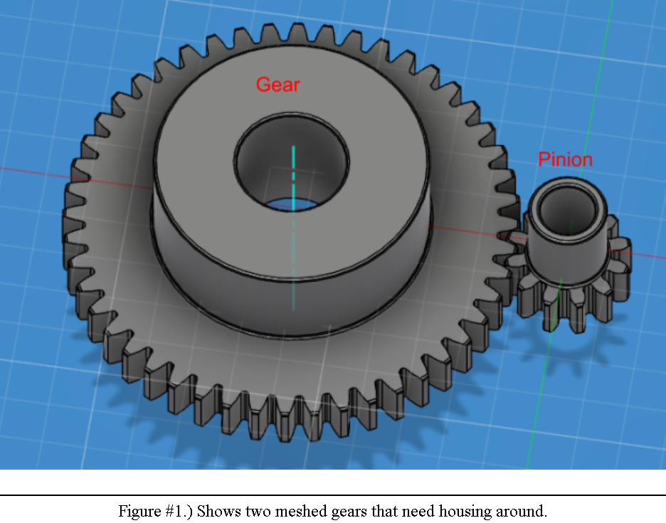

The main goal of this project is to design, perform structural analysis, and build a two-part gearbox that can be assembled and disassembled through fasteners. The engineering analysis involves determining the adequacy of the torsion load on the 0.125 inch diameter input shaft and 0.250 inch diameter output shaft using the equations derived from Machinery's Handbook, and also the optimization of the journal bearing requirements for sizing, pressure velocity (PV), and minimum wall thickness limitations. These computed dimensions would then be used as the constraints in building a complete CAD assembly of parts obtained from McMaster-Carr.

### Assumptions
Ideal Power Transmission Performance: The gear train operates with 100% mechanical efficiency.

Negligible Radial Force Bending Moments.

Equal Lengths For Both input and output shafts.

Bearing length equals the diameter of the output shaft.

The structural thickness analysis of the bearing journal walls takes into consideration the fact that the primary mode of failure is tensile failure (tearing) resulting from the hoop stress created by the fluid pressure/radial stress distribution, so the material Ultimate Tensile Strength is the key limiting factor.

Factor of Safety Value (FOS): A factor of Safety of 4 is taken with respect to material strength values available at MatWeb. It ensures adequate margin to account for dynamic stresses during startup, motor vibrations, and production variations in the porous metallic construction.

## Calculating Input Values

### Knowns and Unknowns
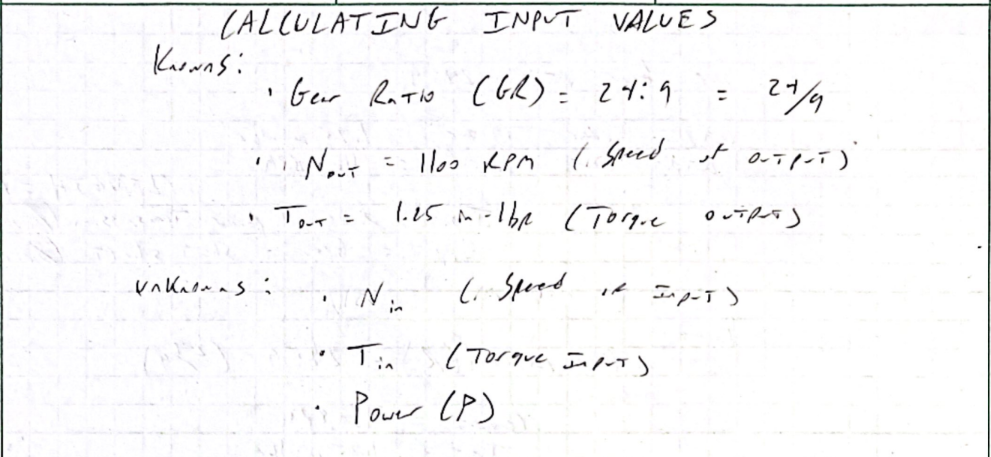

The above shows us the knowns and unknowns:

Knowns:

Gear Ratio (GR) = 24:9

Nout = 1100 RPM (output speed)

Tout = 1.25 in-lbf (output torque)

Unknowns:

Nin (input speed)

Tin ( input torque)

### Calculating Nin and Tin:
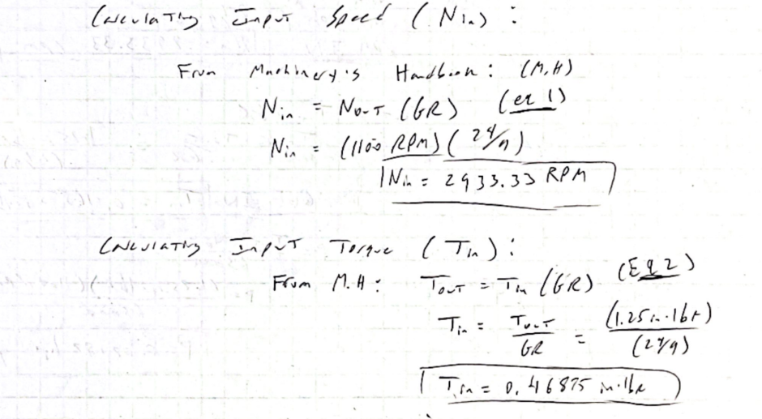

The gear ratio (GR) (24:9) is used to back-calculate the input parameters based on the given output parameters. The input parameters define the initial boundary operating conditions that form the basis for all other shaft stress and bearing-speed calculations. Based on Machinery's Handbook (eq 1), Nin is 2933.33 RPM. With eq 2 (based on Machinery's Handbook), we can find Tin to be 0.46875 in-lbf.

### Calculating Power (P):
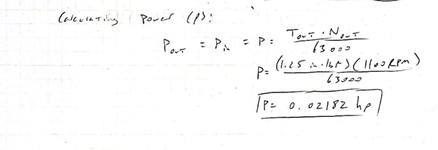

In this gear system, output power is the same as the input power; therefore, we can use either output or input values to find P. Doing this, we get that P equals 0.02182 hp.

## Designing for Input/Output Shafts:
### Knowns and Unknowns:
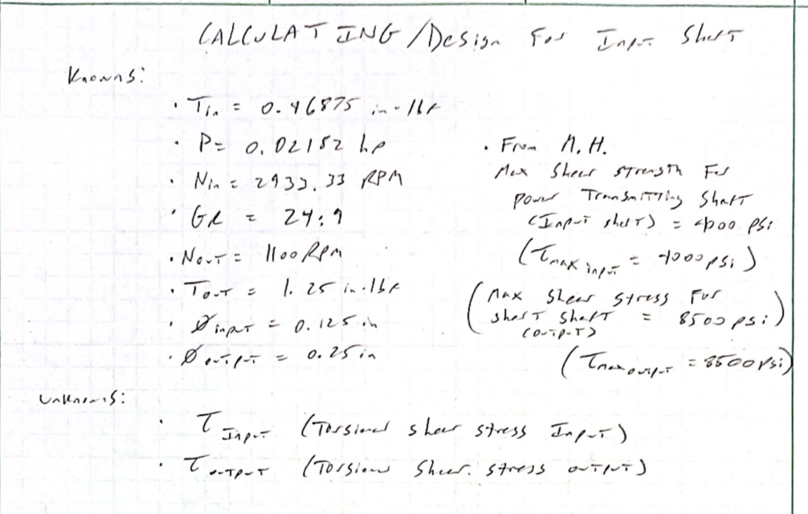

The above shows all knowns and unknowns, respectively. From the Machinery's Handbook, the max shear strength for an input shaft gives a value of 4000 psi, we will use this value as tau_max_input. The Machinery's Handbook also states the max shear stress for an output shaft is 8500 psi; we will use that value as tau_max_output.

### FBDs (input and output)
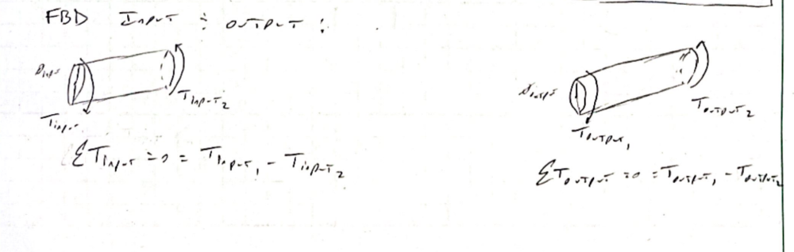

The above shows the FBD of the forces that act on both the input and output shafts. By applying force equilibrium, it is seen that the torsion forces calculated previously (T_input1/T_output1) are in equilibrium with their respective reaction forces (T_input2/T_output2).

### Solving for tau_input and tau_output:
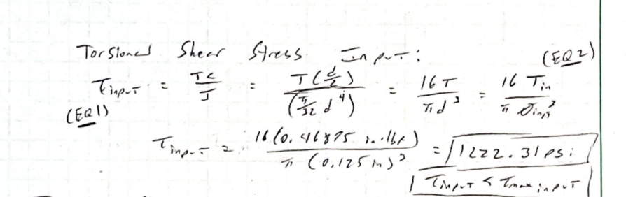
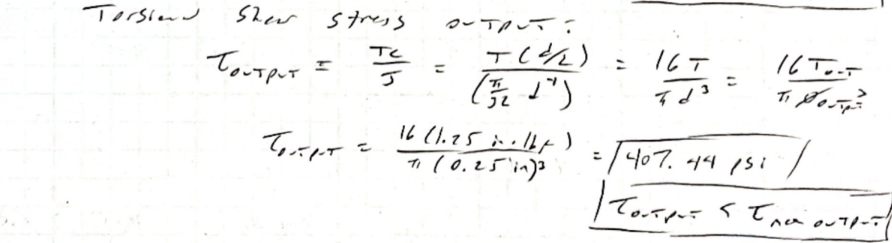

This formula determines whether the selected shaft sizes (0.125 inches for the input shaft and 0.250 inches for the output shaft) are capable of transmitting the torque without twisting. The purpose is to determine the precise size of the journals that will be used to design the inner diameter of the bearings. Using the governing equation (eq 1), we plug in our variables and simplify to eq 2. Then we plug in our values and get tau_input to be 1222.31 psi. Since tau_input is less than tau_max_input, the answer is sufficient; no need to change the diameter.
Using the governing equation (eq 1), we plug in our variables in the same format to get eq 2. Solving for tau_output, we get a value of 407.44 psi. Since tau_output is less than tau_max_output, the answer is sufficient; no need to change the diameter either.

### Length Assumption (input and output):

One of my other assumptions includes having a 1.25-inch shaft length for both input and output shafts. This is a practical assumption since it helps create a symmetric housing depth and makes the CAD design process much easier. In addition, making them of equal length will enable both the input pinion and output gear to have sufficient paths for sliding without touching the internal housing walls at the same time.

## Designing For Journal Bearings:
### Knowns and Unknowns:
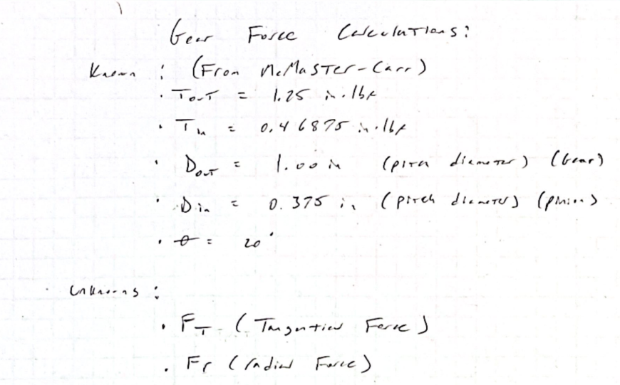

The above shows the knowns and unknowns, respectively. The specific values are from McMaster-Carr [pinion/input](https://www.mcmaster.com/7880K19/) [gear/output](https://www.mcmaster.com/7880K24/). Most importantly, both the pinion and gear share the same gear pitch (48) and pressure angle (20 degrees).

### Gear Forces
The tangential and radial forces acting against the teeth of the gears are determined through the use of the input torque and the pitch diameters. The total resultant force is the real mechanical load that acts laterally on the shafts and must be fully sustained by the journal bearings.

### Solving for Tangential Force (F_T):
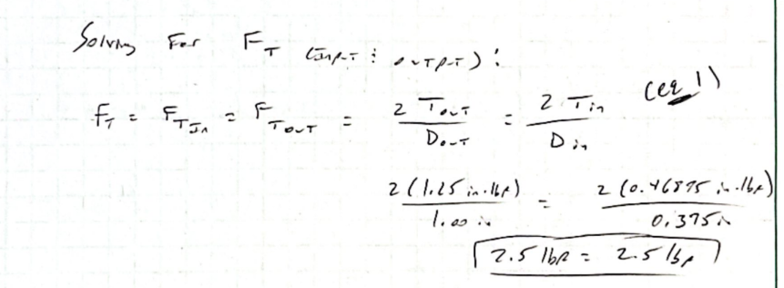

As shown above, using eq 1 connects and ensures the pitch diameter (D_out and D_in) connects alongside the torque calculated previously. Once we substitute our variables, we do get the same answer for both the input and output of F_T.

### Solving for the Radial Force (F_r):
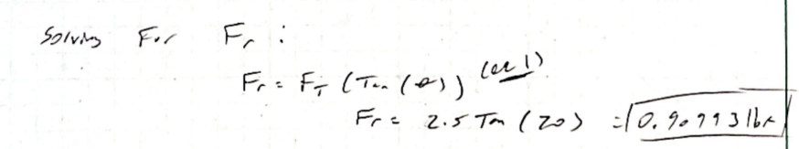

The above shows the governing equation to solve for F_r (eq 1). We substitute our variables, and we get that F_r equals 0.90993 lbf.

### FBD
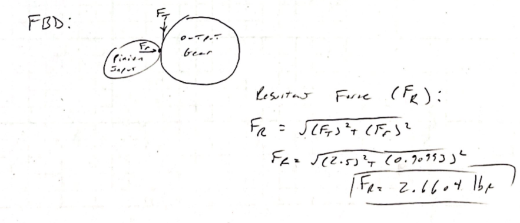

The above shows the FBD of the journal bearing of both input and output shafts. The same forces will be applied to each shaft (FR), along with their reaction forces (FRR). Solving for FR gives a value of 2.6604 lbf, which, due to equilibrium, also equates to the reaction force FRR.

### Solving For Shaft Velocity (Vin and Vout):

The sliding velocity is responsible for the rate of energy dissipation and acts as the second part of the last material check for the PV of the materials. The equation will allow us to convert the speed of the shaft rotation (rpm) into the speed of sliding (feet per minute) right at the interface.

### Knowns and Unknowns:
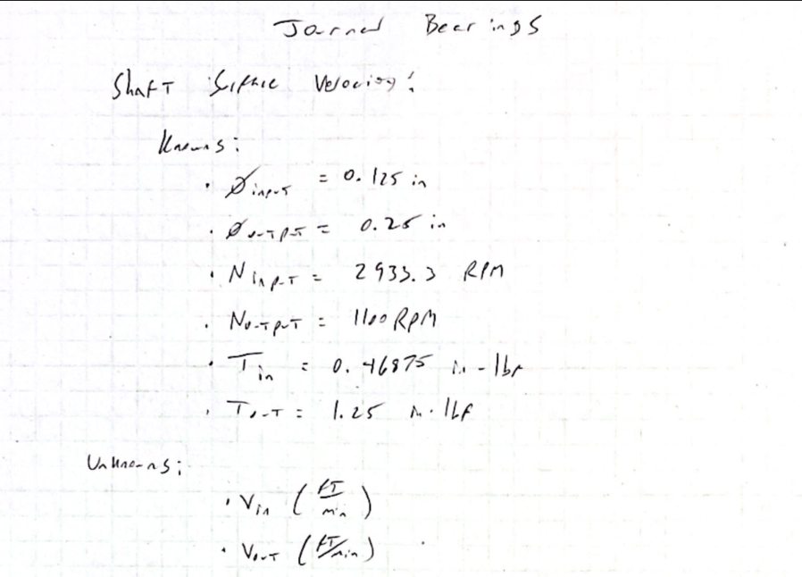

The above shows the knowns and unknowns, respectively.

### FBD
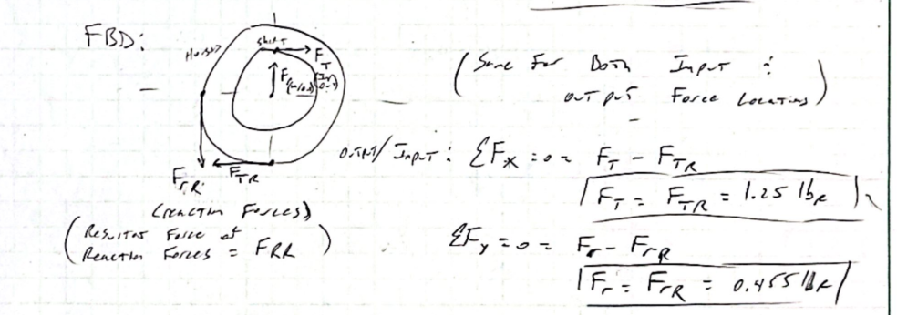
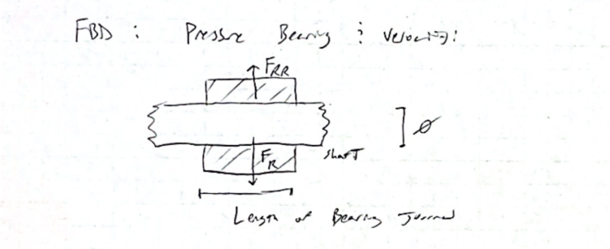

As shown above, the FBD of the journal bearing and the resultant force (FR), alongside the equilibrium force (FRR) will act on both the input and output journal bearings and shafts.

### Solving For Surface Velocity:
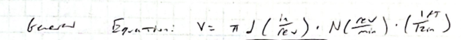

As shown above, we need to convert the velocity to ft/min to have the governing equation (eq 1).

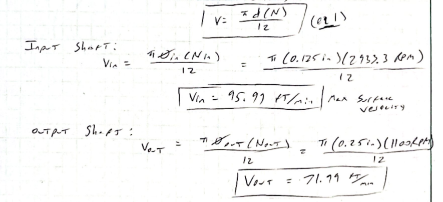

As shown above, using eq 1 and plugging in our variables gives an input velocity (v_in)of 95.99 ft/min. Using the same process for the output velocity (v_out), we get 71.99 ft/min.

### Calculating Bearing Pressure:

The calculation is used to determine the compressive strength that acts on the bearing face and forms the first part of the final PV material selection process. The calculation uses the total pressure that acts on the gears divided by the projected contact area of the single bearing.

### Knowns and Unknowns:
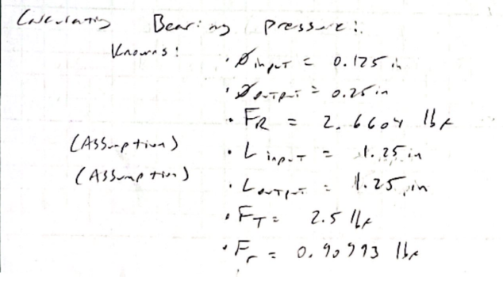
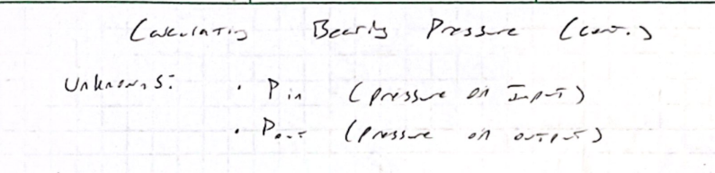

As shown above, the knowns and unknowns are listed, respectively. 

### Solving For Bearing Pressure (Pin and Pout):
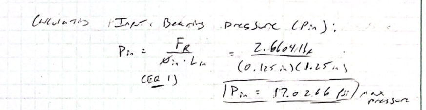
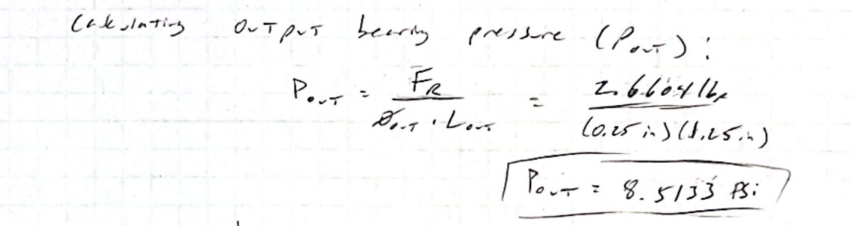

As shown above, using the governing equation (eq 1) and plugging in our variables, we get Pin equal to 17.0266 psi. Solving for Pout in the same format, but changing the output shaft diameter, we get 8.5133 psi.

### Solving For PV:

The product of pressure and velocity yields the operational PV value that is the benchmark criterion adopted for frictional heat generation and wear-out predictions in the industry. The resultant figure helps us in selecting a superior material, from the machinery handbook, to protect the gearbox from melting or wear-out.

### Knowns and Unknowns:
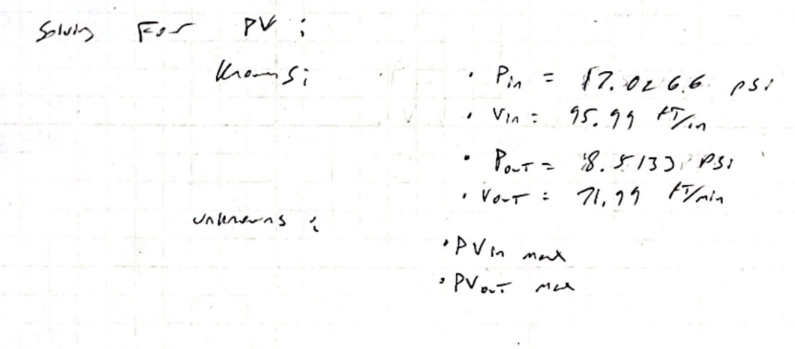

As shown above, the knowns and unknowns are listed respectively.

### Solving for PV max (input and output):
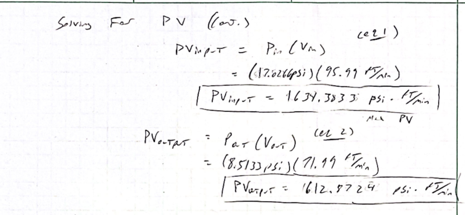

As shown above, using the governing equations for PV (eq 1 and eq 2), we can solve for both PV_input and PV_output. Plugging in our variables, we get PV_input equal to 1634.3833 psi - ft/min and PV_output equal to 612.8724 psi - ft/min.

## Material Selection:
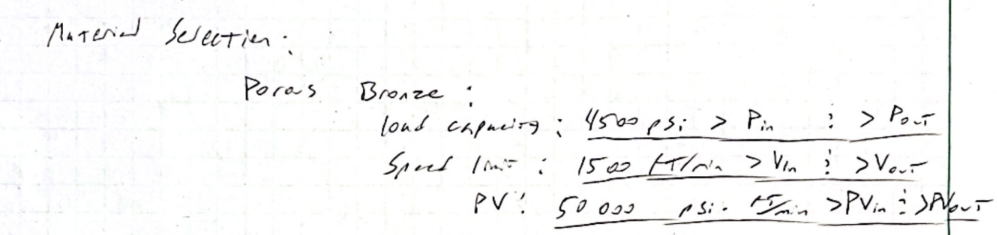
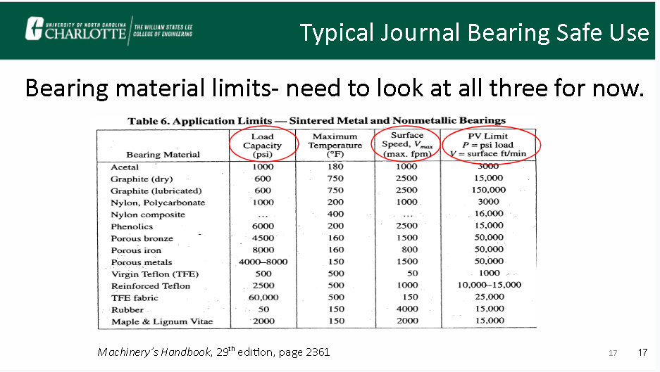

Due to our values, I decided to use Porous bronze as the material for the journal bearings. Porous bronze's high resistivity, with a PV value of 50000 psi - ft/min easily exceeds the max PV value calculated previously. Porous bronze also has a high load capacity of 4500 psi, which also exceeds the max bearing pressure we calculated of Pin (17.0266 psi). Porous bronze also has a velocity constraint of 1500 ft/min, which also exceeds our previously higher velocity variable (Vin) of 95.99 ft/min. Porous bronze was also chosen due to the natural self-lubrication capacity of the oil-filled structure, which does not need any additional lubricant reservoir.

### Thickness of Journal Bearings:

With the use of our calculated value of FOS, the allowable stress can be calculated based on our material choice and related to area, and then the minimum thickness of the material needed to avoid the structural separation of the bronze sleeve due to the internal pressure profile.

### Knowns and Unknowns:
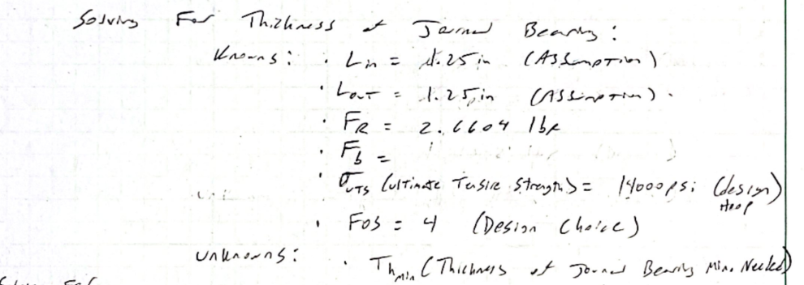

As shown above, the knowns and unknowns are listed respectively.

### Solving For Journal Bearing Thickness (Th_min) and FBD:
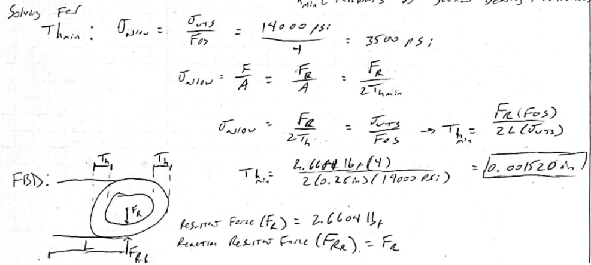
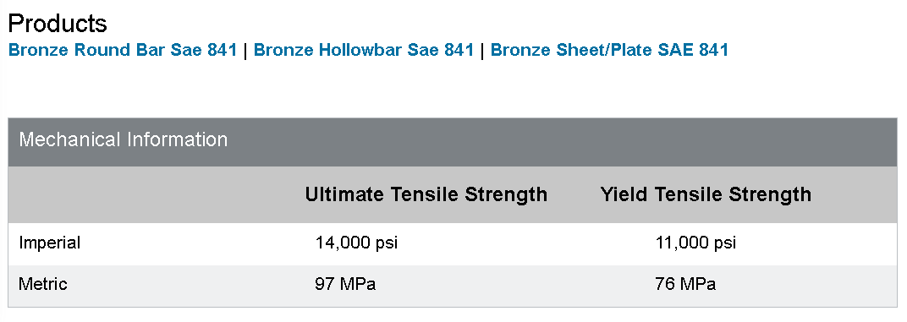

As shown above, the FBD of the resultant force (FR) alongside the reaction force (FRR) with the thickness of the journal (Th). 

Firstly, solving for allowable stress based on our assumed FOS value of 4 alongside our other assumption due to the hoop stress as stated in the problem connecting to the ultimate tensile strength of porous bronze. Using stress equals force over area and allowable stress equals ultimate stress over FOS, we set both equations equal to each other and can solve for the thickness through the area. In solving for Th_min, we get a value of 0.001520 inches. This absolute minimum requirement explains the purchase of a commercially available 1/16 inch thick bushing, which determines the outer diameter of the holes in the housing design.

## Solving For the Diameter of Journal Bearings:
### Knowns and Unknowns:
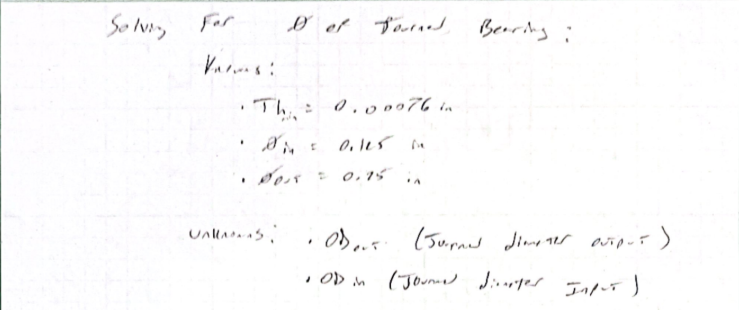

As shown above, the knowns and unknowns are listed.

### Solving for Outer and Inner Journal Diameter:
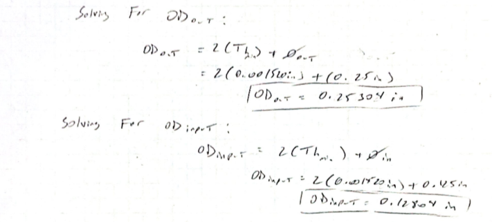

Using the generic equation for the geometry of a hollow-shaped circle, we can find the outer diameter of the journal bearing. In doing this, we get an outer diameter of 0.25304 inches and an inner diameter of 0.12804 inches. The dimensions of the inner and outer diameter of the bushing are specifically set based on the dimensions of the shafts (~0.125 inches and ~0.250 inches) with the use of the standard clearance for sliding fit in industrial settings. These diameters become the basis for the selection of the journal bearings through McMaster-Carr.

Based on these dimensions and what McMaster-Carr offers for journal bearings, I have decided on:

Output Shaft Journal: McMaster-Carr 6391K131

Input Shaft Journal: McMaster-Carr 6391K111

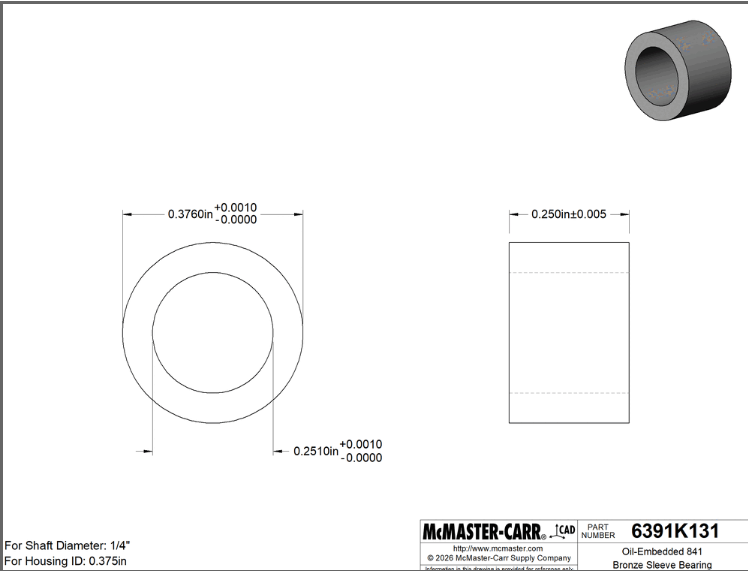
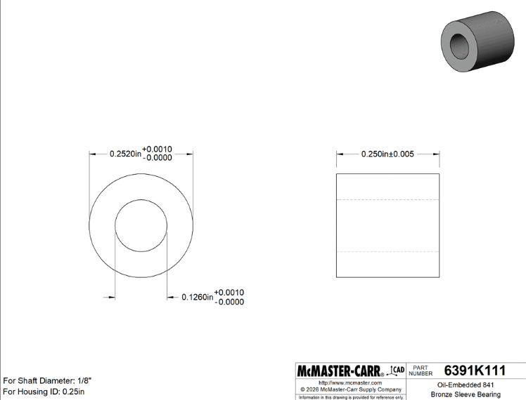

6391K131 and 6391K111 from McMaster-Carr have been selected due to their accurate 1/4-inch and 1/8-inch internal diameters, making the sliding fit perfect for the output and input shafts. In addition, the highly efficient synthetic oil-infused lubricant ensures that the high-speed input shaft operates safely within the specified safety limits.

## Design sketch:

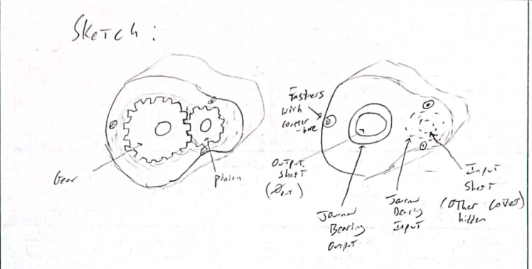

The above shows the sketch of my design. In order to minimize dimension stack-ups, I decided to have an outline of the gears and apply a generous wall thickness to ensure rigidity. I also decided to use fasteners to secure both plates. Each plate will have the journal housing and shaft. I will also add a counterbore to the fasteners to ensure a consistent surface level.

## CAD
### Parametric Variables
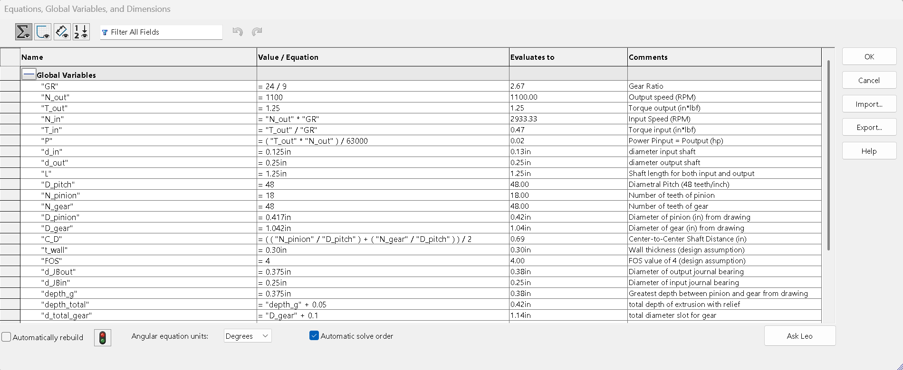
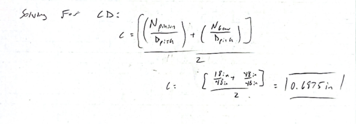

The above shows the parametric equations present throughout the CAD model. Specifically talking about the independent variables present, for my design, I decided to have a 0.30 inch wall thickness to ensure rigidity of the design, as well as to ensure enough solid material to include space for fasteners labeled on my sketch. As for variables such as D_pinion and D_gear, I used the drawing specifications labeled in McMaster-Carr. I used the drawings presented in McMaster-Carr for the journal bearing diameters (d_JBout and d_JBin). Every other independent variable was used throughout the calculation process.

For the dependent variables presented, C_D was calculated using the geometry presented in the second picture. Using the diameters of both gears, the center-to-center distance was 0.69 inches. This spacing ensures the gear teeth mesh seamlessly without binding or slipping.

For the depth variable (depth_g), I viewed both the pinion and gear drawings from McMaster-Carr and used the greatest depth between the gears as a baseline for how much I should extrude both housing plates. For the variable depth_total, I assumed and set the distance from the wall to the closest side of each gear to be 0.05 inches, just so there is no unnecessary friction. For the variables d_total_gear and d_total_pinion, I added a clearance between the edge of the gear teeth and the slot where it will sit, being 0.1 inches, just so there is enough space for both gears to comfortably sit.

### McMaster-Carr Drawings Reference:
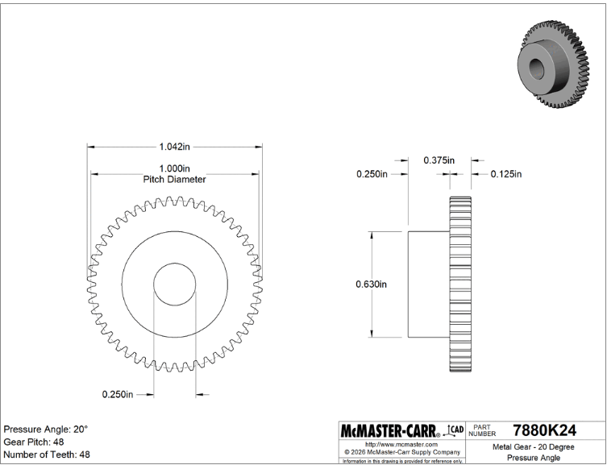
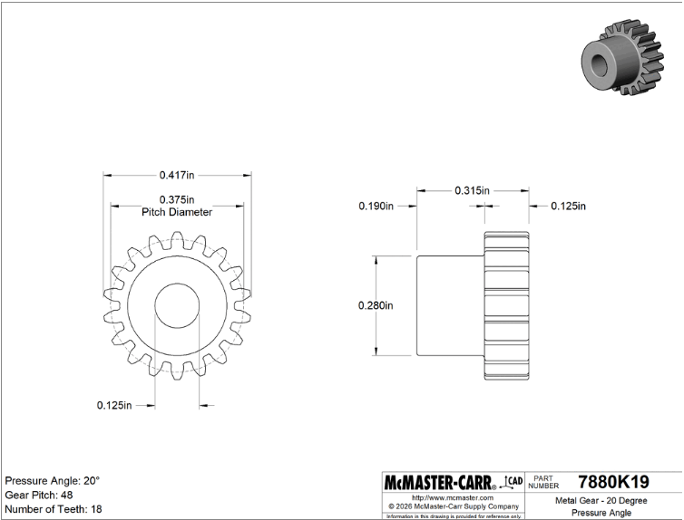

As seen above, here are the referenced drawings and baseline dimensions for the independent and dependent variables.

## Designing Input and Output shafts:
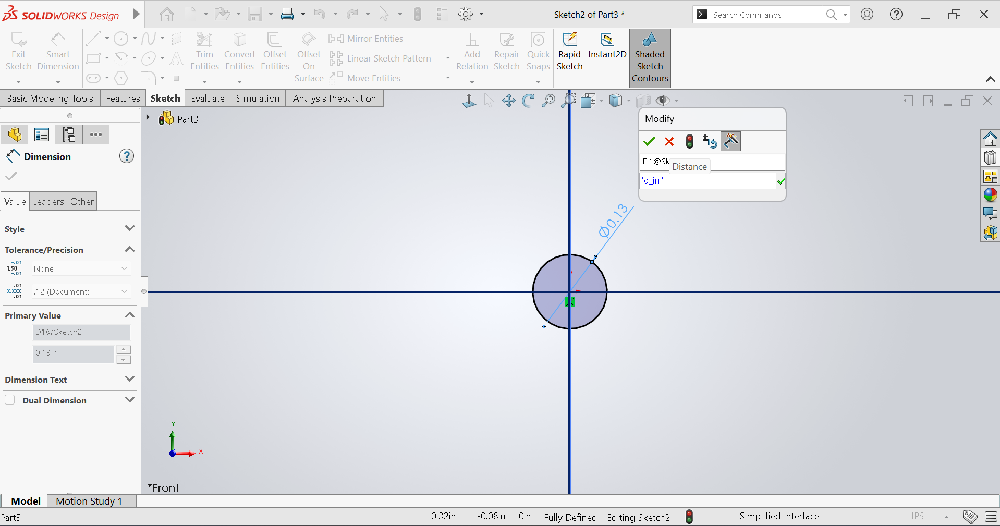
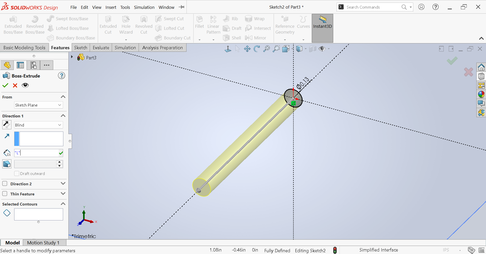

As seen above, I started by designing the simple input shaft using my parametric variable (d_in) and extruding to my assumed design length (L) set for both input and output shafts.

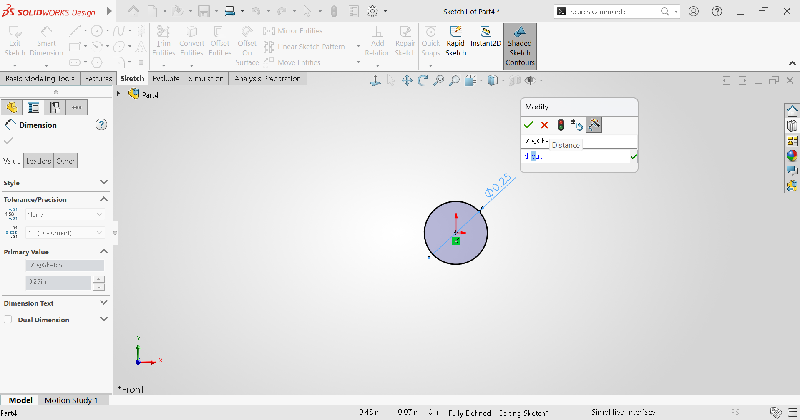
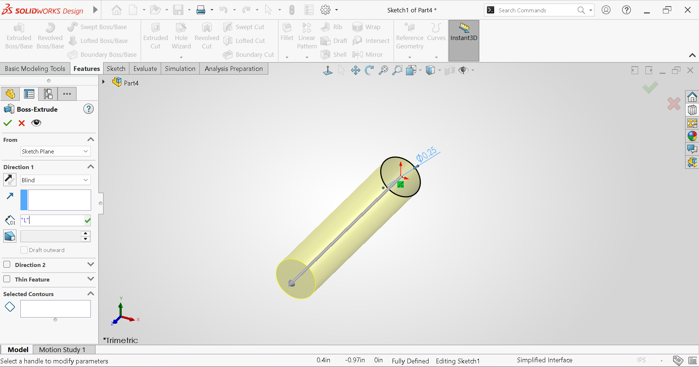

Here I did the same process for the output shaft (d_out) and extruded by L.

## Design Outline:
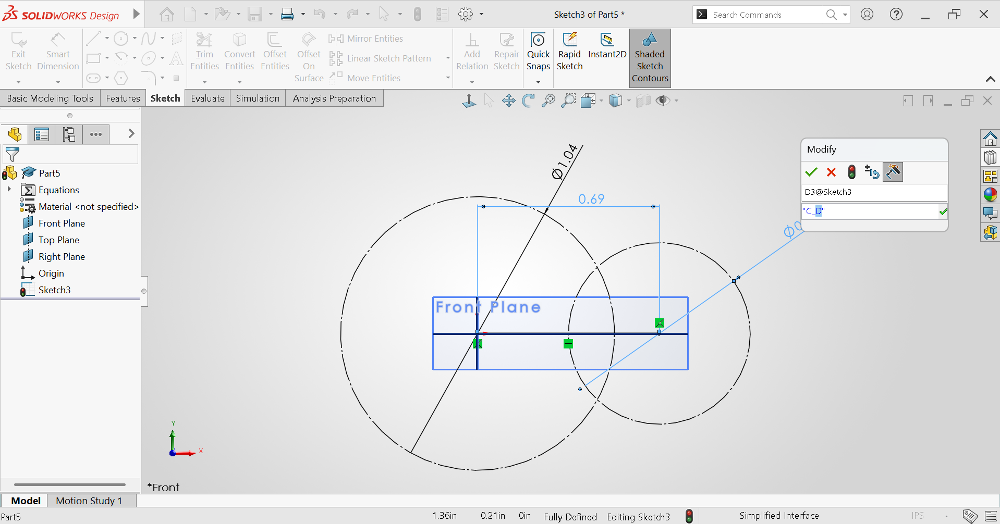
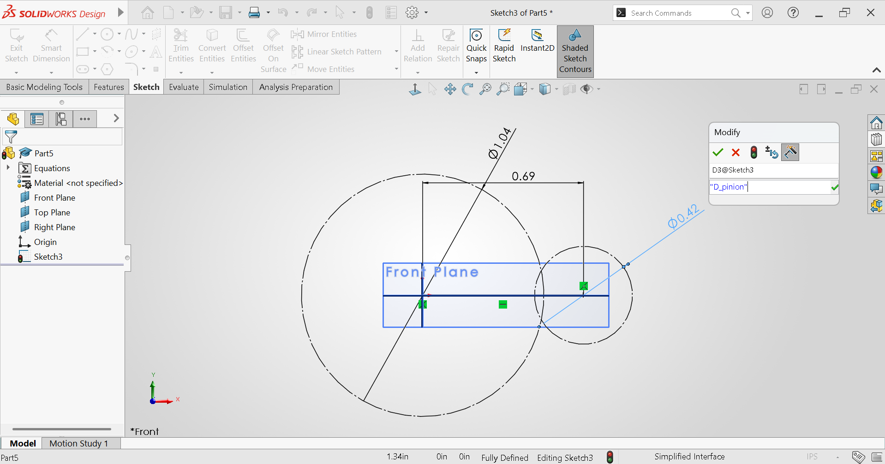
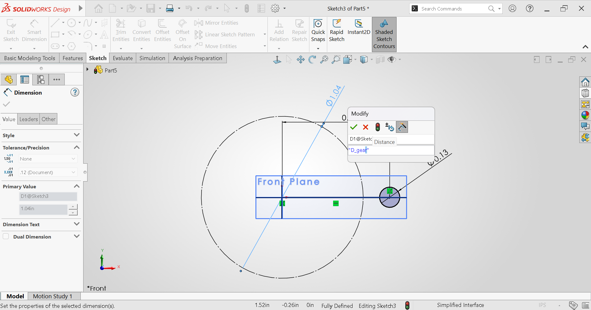

As shown above, I started by using construction lines outlining the placement of the gears and using the variable C_D previously calculated, and ensuring the placement of both gears. The next pictures showcase the use of the independent variables D_pinion and D_gear.

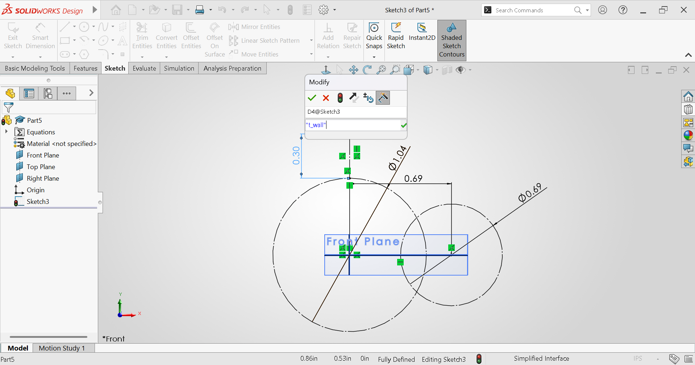
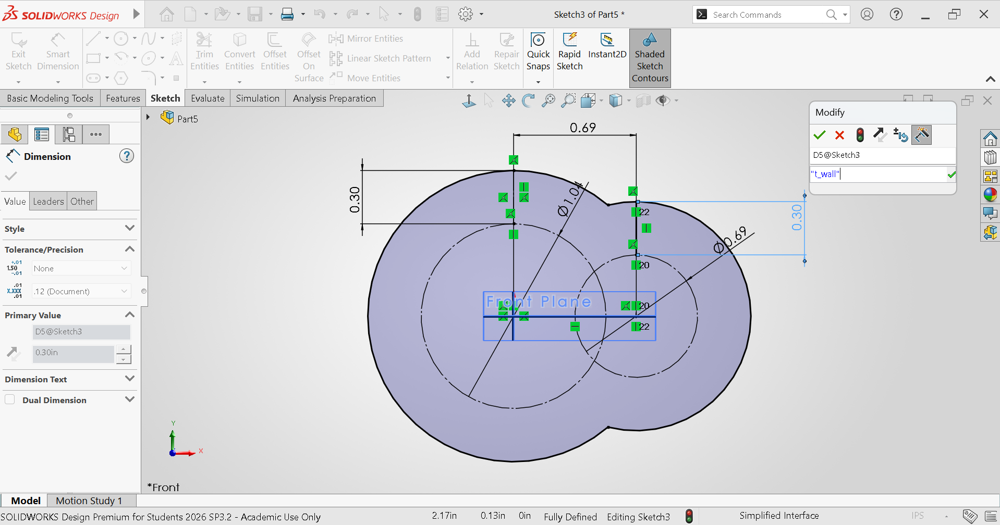

As shown above, I used the outline of the gears and extruded tangentially above both outlines to represent the thickness of each housing plate.

## Design Housing Plates:
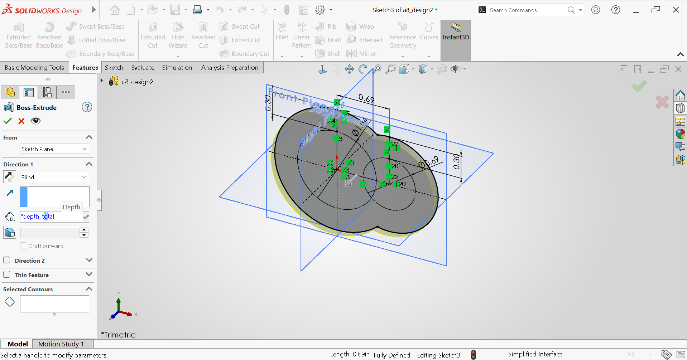

As shown above, I then extruded the outline based on depth_total.

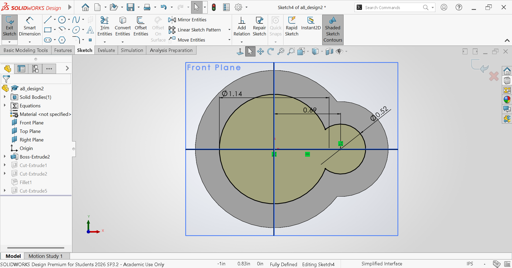
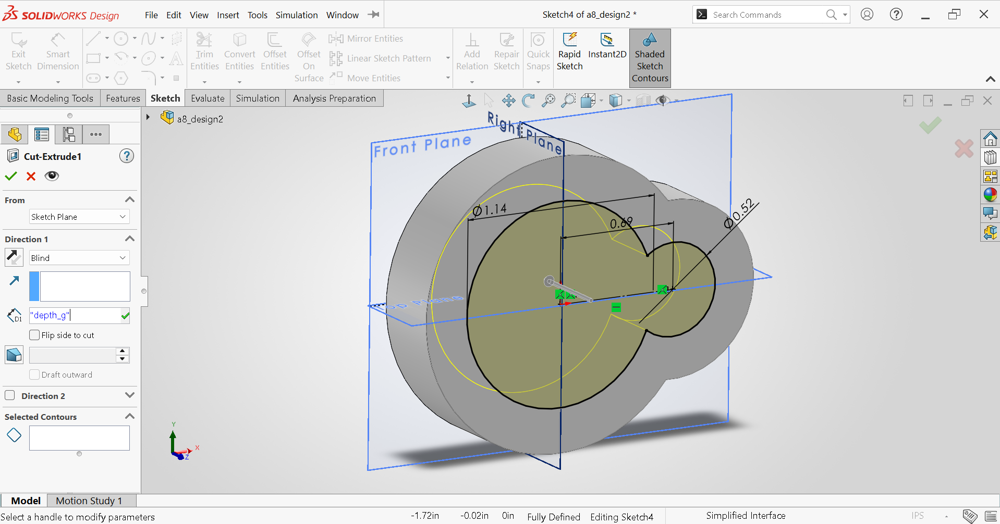

Here I used the outline, added the relief, and extruded the outline to the depth stated in the parametric variables.

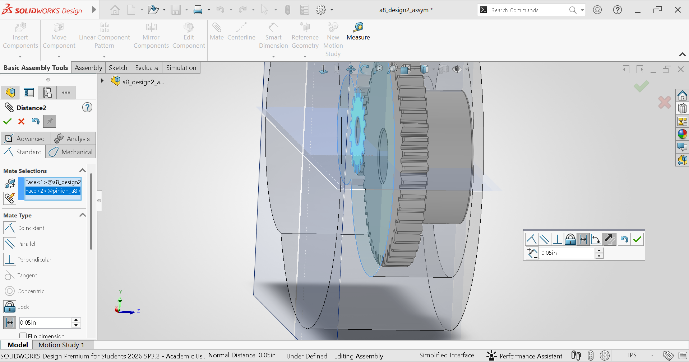

Above, I then checked the assembly so far, ensuring everything fit, and added the distance from the plate wall. The second picture then ensured that the distance C_D is reflected on both gears.

The above shows the input bearing journal diameter being extruded out on the plate (d_JBin).

I then saved a copy of the design so far and added the output bearing journal diameter to the other housing plate (d_JBout), all while still maintaining the C_D distance.

I then checked again within the assembly to ensure that everything was aligned correctly by constraining both gears with d_JBin and d_JBout.

I then added fillets on the inner sharp corners of the outline to save space and to avoid large stress concentrations.

I then added the fastener holes as my sketch showed. Using the clearance from the wall thickness (t_wall), I decided to use an M1.6 x 0.35 mm Thread Size, 16 mm Long fastener. In my design, both housing plates are 0.42 inches (depth_total). The longest M1.6 x 0.35mm fastener McMaster-Carr provided was 16 mm, but it does fasten both plates reasonably. I then added a counterbore to ensure an even surface level. I then extruded the same shaft hole dimensions on the other plate.

As shown above, this is what the assembly looks like so far, ensuring the constraints automatically through SolidWorks.

As shown above, I added the second plate to the assembly and made the housing plates transparent to show no unnecessary contact. I also added both shafts and housing journals to their respective slots. 

As shown above, the journal bearings are inserted and constrained.

This shows the final design.

## Design Material Selection:

Based on the context of this problem, I decided to make the housing material out of aluminum 6061-T6. The aluminum 6061-T6 would be an ideal material for the gearbox housing due to its ability to resist the internal (FR) 2.6604 lbf forces resulting from the gear mesh owing to the high structural rigidity of this material; it will not only help prevent misalignment but also maintain perfect gear meshing. The machinability of the aluminum 6061-T6 makes it possible to bore the 0.250 and 0.375 inch pockets accurately.

## Lessons learned:

Initially, I tried designing the gearbox as an actual box. I initially tried to outline both gears and sketch a box around the gear system. I then tried to add enough solid material to add 4 fasteners with counterbores. Although this design did work, I did not find it efficient and found it difficult to parametrically design it due to the dimension stack-ups. Due to the process that I took on this design, I had a lot of dimensions that I could not explain parametrically with the information given from the geometry of the gears.

Overall, I felt that the design was not efficient with the material or amount of fasteners; it also included dimensions I could not back up parametrically.

As for overall lessons throughout the assignment, I learned that by solving for the critical component of the gearbox housing being the journal bearings, and narrowing down the material and dimensions, allowed for a baseline of the geometry of the CAD model. From solving the bearing journals, it's possible to identify important limitations in the form of width and depth requirements that also end up increasing the size of the housing above the original estimations (dimension stack-ups). This project showed that using parametric equations to relate performance profiles to the geometry allows for a highly flexible and adaptable design.

## Work

[CAD](a8_design2_assym)

[Work](A8_work.pdf)

## Communicate
Time: 14 hours

