# A9 – Pulleys
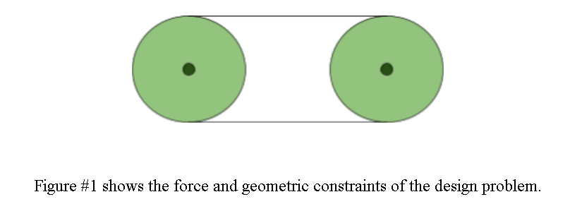

## Objective
The purpose of this project is to develop a highly efficient power transmission pulley system that would function with a center distance of 5.0 in and a speed of 1500 RPM while ensuring a safety factor of 3.0 or greater. By using a polyurethane elastomer belt with a yield strength of 471 psi, the system is pre-loaded to 5.0 lbf to determine static belt forces (F1 and F2), minimum belt cross-sectional area, and belt pitch length. AISI 1060 as-rolled steel is used as the material for sizing the drive shafts of the system by using the maximum shear stress condition for the shafts. In order to accommodate the shafts subjected to radial loads, an engineering analysis is performed to find out the journal bearing material considering its maximum permissible limits for pressure (P), linear sliding velocity (V), and PV rating. In this design, we are also assuming that this is a frictionless pulley system where the coefficient of friction (u) equals 1.

## Chosen Values:
5.0 in as the center distance within the range of 4-6 in because it is at the midpoint of the geometric constraint, allowing for good clearance between the two 3 in pulleys while keeping a compact frame size

1500 rpm as the speed within the range of 1000-2000 rpm to have the right power-transmitting ability and low surface velocity of the journal bearing to avoid the breakdown of the lubricant due to heat.

5.0 lbf as the static tension within the range of 4-6 lbf to provide sufficient normal force to prevent slipping of the belt and reduce stress on the belt.

## Belt Values:
### Knowns and Unknowns:
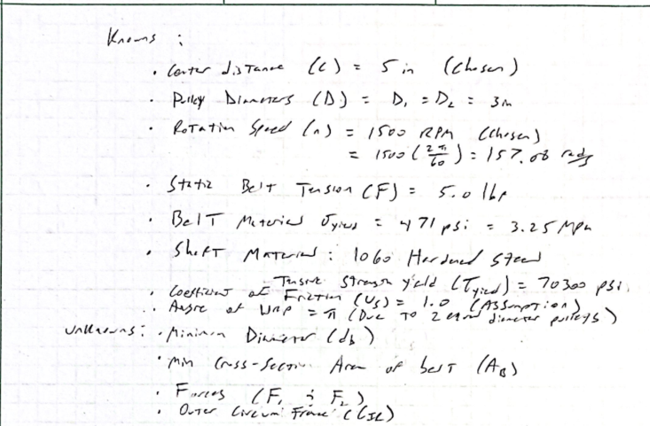

Here are the lists of the values given alongside the chosen values and assumptions. This section specifically solves for the belt dimensions and forces.

### Belt Forces (F1 and F2):
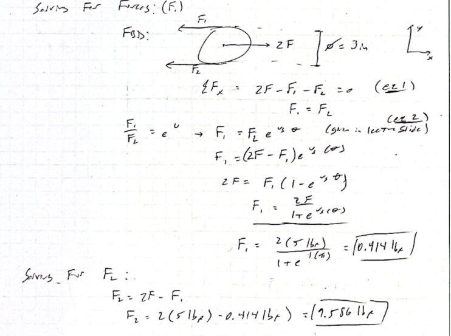

In order to find the belt forces, the dynamic belt tensions on the tight side (F2) and the loose side (F1) are determined based on the static equilibrium and belt friction concepts. The total system reaction force is found from static equilibrium (eq 1), which states that the sum of the dynamic belt tensions equals twice the chosen static tension (2F). Secondly, the equation for flat belt friction (eq 2) is used, assuming the following governing conditions: the pulley wrap angle is equal to pi (θ = π), and the maximum non-slip friction coefficient is u = 1.0. After substituting into the friction equation, we isolate F1 as 0.414 lbf and find F2 as 9.586 lbf.

### Solving For Belt Area (Ab):
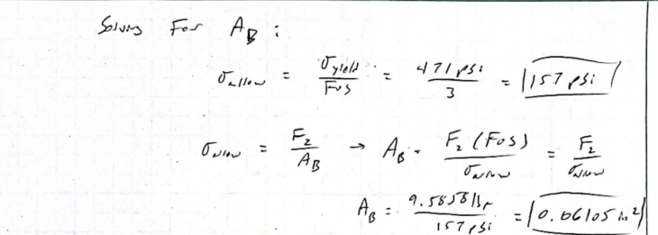

Based on the given yield strength of the polyurethane rubber (471 psi) and the factor of safety (FOS) of 3. We can find the area of the belt needed through the allowable stress and F2. By substituting both equations into each other and eliminating the allowable stress, we get a minimum area of the belt (Ab) equal to 0.06105 in^2.

### Solving for Belt Diameter (db):
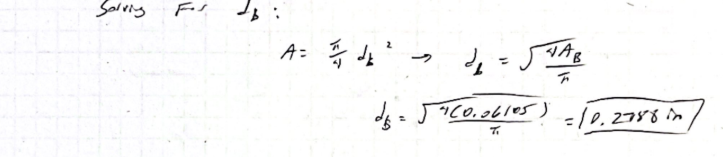

Based on the solved Ab, we can use the assumed geometry of the belt and isolate db. In doing so, db equals 0.2788 inches

### Solving For Outer Circumference (CIR):
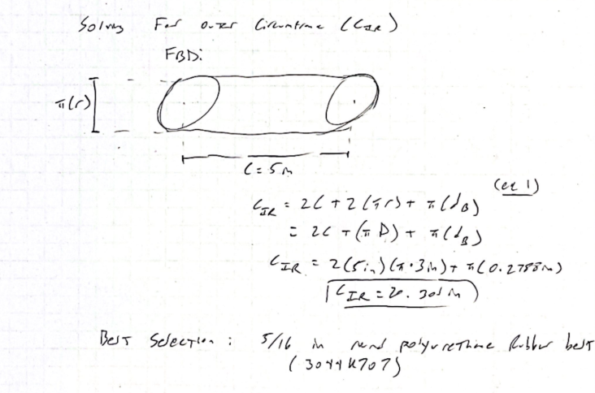

In order to calculate the necessary outer circumference of the belt, the geometry of the two-pulley drive system is modeled based on the chosen center distance and the minimum belt diameter found from eq 1. The geometry of the pitch length is constructed as the sum of twice the center distance between the pulleys (2C = 2 * 5.0 in = 10.0 in) and twice the wrap angle over the two identical pulleys (2*pi*r = pi*D). In order to take into consideration the physical diameter of the round belt, the outer diameter correction factor (pi*db) is added to eq 1 by means of the minimum belt diameter found (db = 0.2788 in). This gives the total outer circumference of the belt as about 20.301 in.

### Belt Selection:
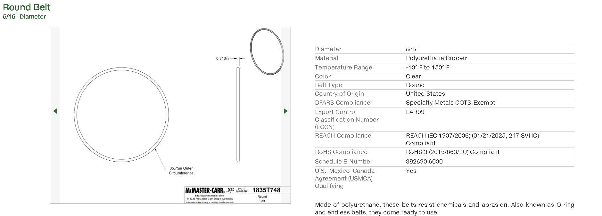

We chose a standard round belt with 5/16 in diameter since it is the closest to our standard commercially available belt and is bigger than our minimum calculated diameter of 0.2788 in. This choice ensures that the normal stress remains well below the allowable value, thus maintaining our factor of safety of 3.0. The part number of the specific polyurethane rubber belt is 3044K707.

## Shaft Values:
### Knowns and Unknowns:
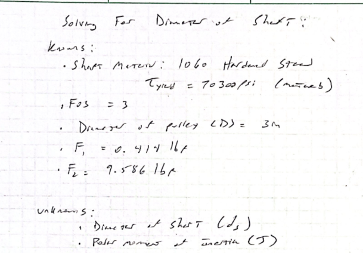
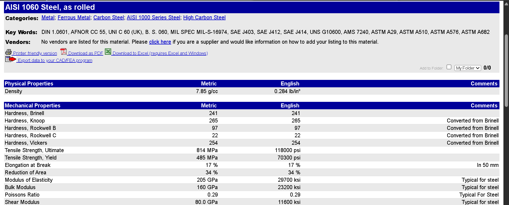

This shows the 1060 Hardened Steel tensile yield stress based on MatWeb, alongside all other values we solved for. In this section, we will focus on solving for the shaft dimensions needed.

### Solving for Minimum Diameter of Shaft (ds):
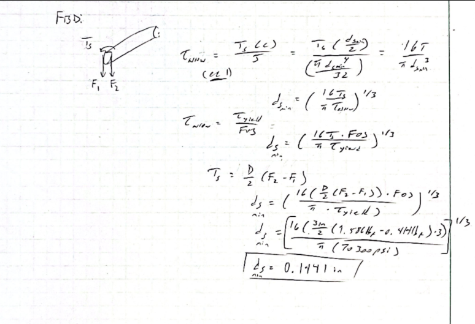

From the FBD, we can use the geometry of the shaft and solve for the allowable torsion shear stress using the generic equation (eq 1). Since this shaft is a solid cylinder, the polar moment of inertia (J) is (pi*d^4)/(32). Using J, we can isolate the diameter of the shaft and solve. In doing so, ds is 0.1441 inches.

## Solving For Journal Bearing Values:
### Knowns and Unknowns:
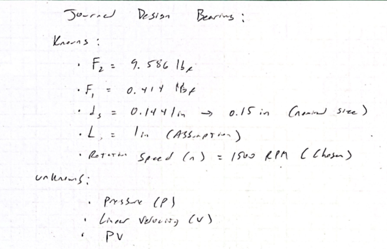

The above shows the knowns and unknowns of the parameters we have so far. As for the shaft diameter, I rounded up the value to a convenient number for manufacturing: 0.15 inches. I decided to use 1 inch as the shaft length, which would help keep a proper length-to-diameter ratio and ensure bearing pressure (P) is much lower than the material strength of our journal bearings.

### Solving For Pressure (P):
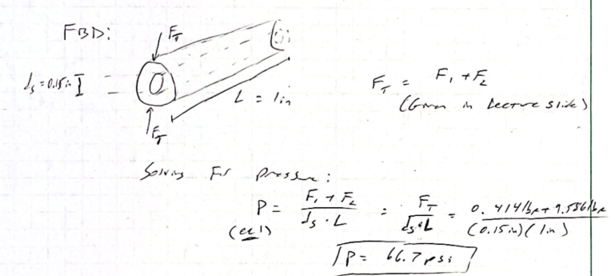

The above shows the FBD of the journal bearing alongside the shaft inside it. Summating the forces (FT) allows for a static force equilibrium also shown in the FBD.

Solving for P using the formula shown in eq 1. Substituting the total summation of forces (FT) over the product of diameter and length gives a pressure of 66.7 psi. 

### Solving For Velocity (V):
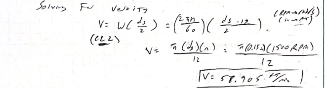

Using the same FBD, the given equation for velocity (eq 2) allows us to plug in our chosen rotation speed (n) in terms of rad/s, along with the diameter of the shaft. We need to convert the diameter to ft instead of inches. In doing so, the velocity equals 58.905 ft/min

### Solving For PV Rating (PV):
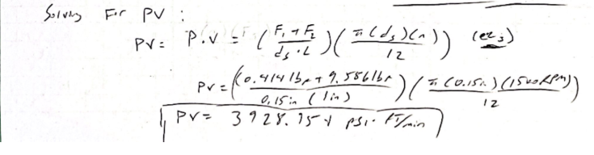

Using the same FBD, we can use the given equation for the PV rating (eq 3); in doing so, we substitute our variables and determine a PV rating of 3928.954 psi* ft/min.

### Journal Bearing Material Selection:
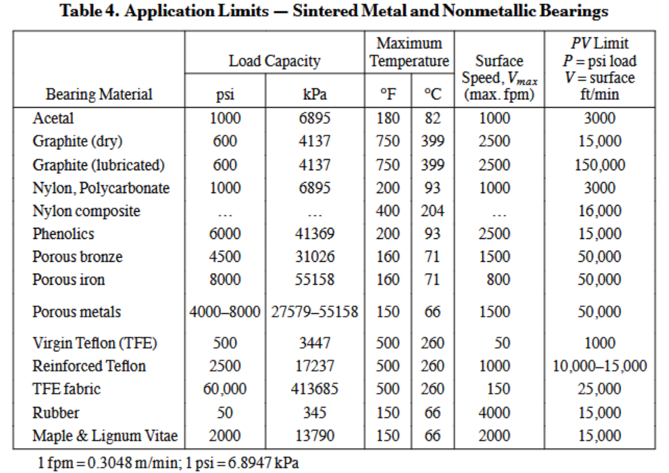

Based on Table 4 of Machinery’s Handbook, the material best suited for the calculated journal bearing values is porous bronze. As shown above, the porous bronze has a max bearing pressure of 4500 psi, which is less than our P value, a maximum surface speed of 1500 ft/min, and a PV rating of 50000 psi * ft/min. These values show that porous bronze will withstand the load calculated by the pulley system. 

## Frame Design:
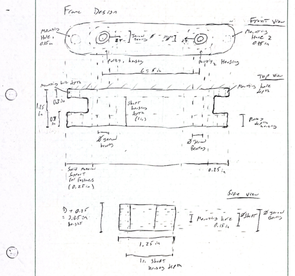
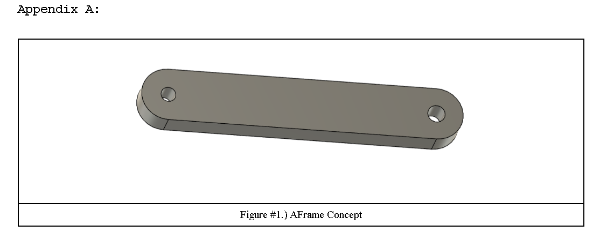

As shown above, I used Appendix A as a reference for how I would design the pulley frame. I maintained the circular geometry to have the most efficient material usage. I added mounting holes on the sides, allowing it to mount on a vertical wall. 

I decided to add 0.25 inches of solid material from the pulley housing to the journal bearing as I felt that this was suitable for the total forces being acted in this pulley system. As for the depth of the frame, I decided to have 1.25 inches to ensure there is enough material to hold the pulley system and ensure the pulleys and shaft length have sufficient room when assembled. I decided to also cut material where it was not needed to make it more efficient by cutting the solid edges where the mounting bolts go through while also ensuring that the actual depth of the pulley housing was still able to fit. In order to have a good ratio of depth to material cut, I decided to use 0.7 inches of solid material for the pulley housing, alongside having solid material behind it and 0.3 inches of material for the mounting holes. Although this is most likely not efficient, I wanted to design it differently from Appendix A. I allowed enough general material from the length of the frame to support the pulleys and center distance (C). As for the height of the design, I decided to have it slightly bigger than the diameter of the pulleys (D) to ensure there is enough solid material for the forces, and I went for a total height of 3.25 inches.

## Communicate
Time: 7 hours

## Work
[Work](A9_work.pdf)
