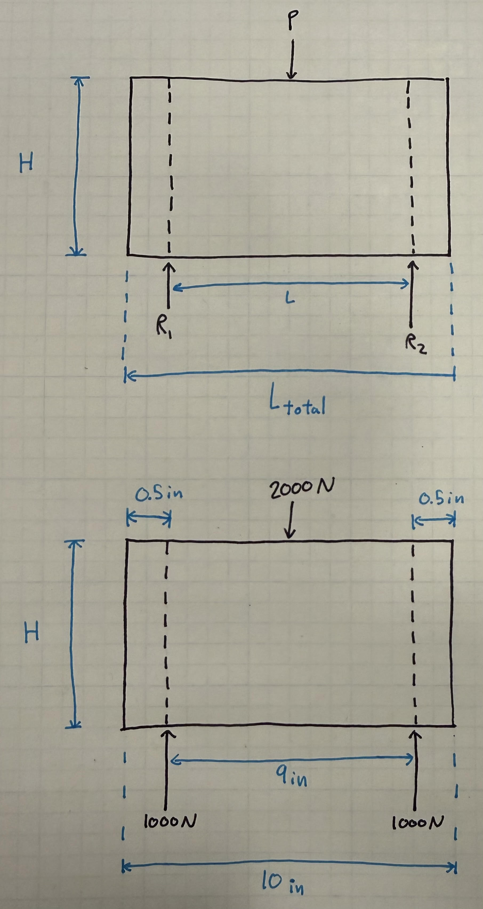
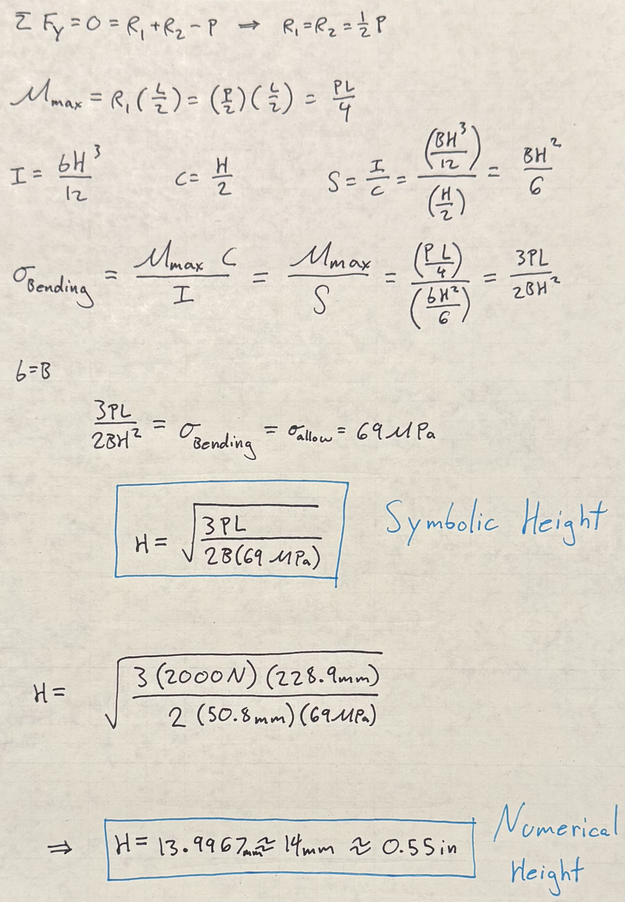
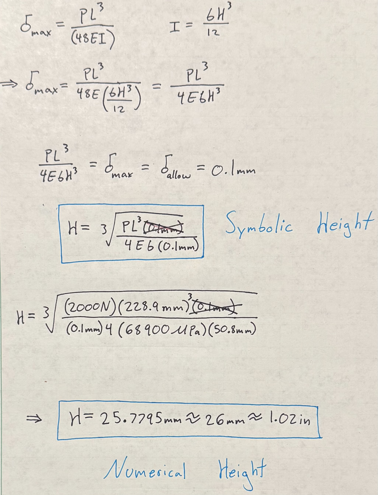
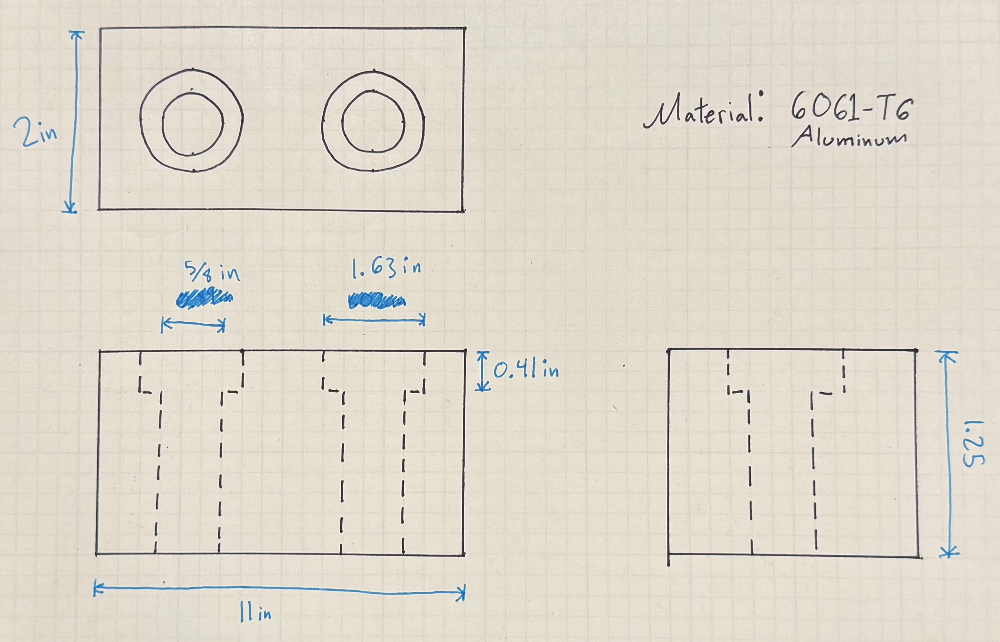

# A10 – Lead Screw Translating System

## Objective

This is a group project, everyone's names are included in the portion they completed. The group members are Saeed Malik, Sebastian Mateus and Sanjay Kashyap.

Description:
A tensile tester is a mechanical testing device used to measure how materials respond to uniaxial tension. It applies a controlled pulling force to a specimen while recording the resulting elongation, allowing engineers to determine properties such as yield strength, ultimate tensile strength, and elongation at break. This data is essential for understanding a material’s mechanical behavior and suitability for design applications.

Design and build a mechanically driven tensile tester capable of applying up to 2 kN axial tensile load with a controllable crosshead speed from 1 to 50 mm/min. Each team is responsible for the mechanical components outlined below. The system will provide consistent, well-aligned loading for polymers and light metals, suitable for instructional use and basic materials evaluation.

Part 1 Scope of Work - Develop a lead-screw–driven crosshead
- Ensure accurate
- repeatable load application to 2 kN with minimal crosshead deflection and misalignment.
- Provide robust specimen grippin
- Simple calibration provisions (mechanical), and safe, ergonomic operation.

Key Constraints

- No electronics, no software: purely mechanical.
- Load capacity: 2 kN (with appropriate safety factor in structure and drivetrain).
- Speed range: 1–50 mm/min (achieved via screw lead selection).
- Form factor: bench-top footprint favored; manageable overall height; 18 inch leadscrew minimum.
- Safety Factor: 4

## Analyze (Sebastian Mateus)

The medium carbon steel has a maximum average yield strength of 684 MPa (Matweb) and can easily handle the crosshead loading of 2 kN while providing a safety factor (FOS) of 4. The hardness and stiffness of the material will not allow any kind of wear to occur due to friction, and it will not bend the screw due to its 18 inches long span. In addition to all of that, it is readily available and is very cheap compared to other alloys or stainless steels.

## Solving for the minimum diameter (axial loading) (Sebastian Mateus):
### Knowns and Unknowns:

As shown above, the listed knowns and unknowns.

I decided to choose a length (L) of 18 inches due to my goal of having the most cost-effective and efficient lead screw setup. Setting the length to 18 inches allows for proper clearance and thread engagement of all components during the tensile test. Using the given FOS value, we can calculate the required allowable stress.
### Determining minimum diameter:

As shown above, the FBD visually tells us that both lead screws equally distribute the crosshead load (2kN); both F_lead values are 1kN.

The assumption for determining the minimum diameter is based on having the lead screws be under axial load only.

In the second picture, eq 1 shows the axial load formula connected to the yield and FOS values. Setting both equations equal to each other allows us to isolate and expand the cross-sectional area (A) and solve for diameter_min (eq 2). In doing so, diameter_min equals 0.107 inches.
### Sizing up minor diameter:

As shown above, the table allows a selection of lead screws. From our calculated values, we decided to select the 3/8 - 8 STUB lead screw.
Key specifications of this lead screw include:

Lead (c) = 0.125 in/rev
(Keeps the required motor speed low while remaining shallow enough to stay safely self-locking.)

Static Load Rating = 1200 lbs
(1200 lbs per screw, which provides a slight safety buffer. This is optimal for the load per screw (1 kN) to absorb shock or slight misalignment without excessive over-design or failure.)

Minor Diameter = 0.265 inches
(The core diameter is more than double the theoretical minimum core diameter of 0.107 inches, making sure that there will be no buckling of the column within the 18 inches of span with a safety factor of 4 under both axial and torsional loading conditions.)

Forward Drive Efficiency = 42%
(Having 42% efficiency, Acme thread is selected since it means reduced loss due to friction and enables the system to work with a small and economical motor.)

Screw Weight = 0.280 lb/ft (.42lbs per screw)
(Light-weight screws have low rotational inertia, which makes the overall system lighter and affordable to transport and mount.)

Overall, the selection provides a very robust and efficient use of thread geometry.

## Solving for Range of Rotational Speed (w) (Sebastian Mateus):
### Knowns and Unknowns:

The above shows the knowns and unknowns based on the given and calculated values.

### Solving for (w) speed range:

Based on the general equation relating linear velocity to rotational speed through the lead/thread start (eq 1). Eq.1 allows us to get the required units of RPM, and using both ends of the given linear speed range, we can translate it to a range of rotational speeds.

In doing so, we get a minimum value of 0.315 rpm and a maximum value of 15.748 rpm. This range allows us to determine the motor.

## Determining Max Torque (Tmax) (Sebastian Mateus):
### Knowns and Unknowns:

Above shows the list of all parameters we know, calculated, assumed, and missing. We assumed a coefficient of friction to be 0.16 based on the 2 mating materials being hard carbon on carbon; this also helps determine the max torque needed, as it provides a worst-case scenario, assuming no lubrication and pure metal-to-metal contact.

### Solving for Tmax (Sebastian Mateus):

Based on the FBD above, the lead screw experiences half of the total crosshead load in compression, based on the crosshead being elevated and the reaction force of the material pushing back downward, which is transmitted to the leadscrew. Then there is the torque being transmitted by the motor to the leadscrew.

Since torque equals the cross product of force (F) and lever arm (R), we can translate eq 1 to have torque on the left side by dividing by the lever arm. In doing so, we get eq 1, which relates torque to the thread geometry.

Pitch radius of screw can be found by taking the average pitch diameter of both the major diameter (⅜ inch) and minor diameter (0.265 inch) and dividing the average by 2 for the radius (this is seen in eq 2).

Substituting our variables in for eq 1 and setting the left side equal to torque, we get Tmax equal to 10.05 in-lbf per screw. This causes the total maximum torque for both screws to be 20.1 in-lbf.

## Leadscrew Selection (Sebastian Mateus) :

After calculating the theoretical minimum minor diameter of 0.107 inches, I decided to increase the overall dimensions to make sure the leadscrew is readily available through standardized diameters. Since the initial assumption of the leadscrew load being only axial, in real-world application, leadscrews experience different types of loads; given the FOS value of 4, I decided to have a 3/8-inch lead screw (which has a minor diameter of 0.265 inches). Then, given my design assumptions of no column buckling, the big increase in solid material makes sense within the context of the tensile tester. The 3/8-inch lead screw also keeps the safety factor of 4 throughout the 18-inch span, without resorting to unnecessarily heavy and costly material. Additionally, with 42% forward drive efficiency and a lead of 0.125 in/rev, the maximum torque of the motor remains low, at 20.1 in-lbs, in the range of 0.315 to 15.75 RPM. Overall, due to the thread profile providing more solid material to sustain the loads, this results in a better strength-to-weight relationship.

## Communicate
Time: 7 hours

## Work (Sebastian Mateus)
[A10_SEBASTIANMATEUS](A10_SEBASTIANMATEUS.pdf)

## Designing Nut and Flange (Saeed Malik)

I had to analyze the internal threads of the nut to then select a proper bronze nut/flange.

### Knowns

Firstly, I started with the known values I had. These were total Force, lead screw count, safety factor, individual force value, diameter, thread pitch and length. At the top of the page are the nut and flanges I selected after finding all the necessary values.

### Unkowns

Next up was writing down all of our unknown values, along with a Free body diagram of our part with dimensions labeled.

### Equations

Lastly, I algebraically and then numerically solved for bending stress, allowable stress and Force values. These values then allowed me to make the selections previously listed.

### Starting Selection (Sanjay Kashyap)

My teammate's lead screw selection is:

<ul>
  <li>Thread type: Acme</li>
  <li>Nominal diameter: 3/8 in</li>
  <li>Thread: 8 TPI</li>
  <li>Lead: 0.125 in/rev</li>
  <li>Two identical lead screws</li>
  <li>Maximum tensile load: 2,000 N</li>
  <li>Safety factor: 4</li>
</ul>

  I have chosen Bronze Nut: 95072A124 
  <a href="https://www.mcmaster.com/products/lead-screw-nuts/thread-size~3-8-8/">https://www.mcmaster.com/products/lead-screw-nuts/thread-size~3-8-8/</a>

Below are the specifications of Bronze Nut: 95072A124

<ul>
  <li>673 bronze</li>
  <li>3/8"-8 Stub Acme</li>
  <li>Single start, 0.125" lead</li>
  <li>5/8" nut length</li>
  <li>9/16"-18 external thread</li>
</ul>

  I have chosen Flange: 95082A641 
  <a href="https://www.mcmaster.com/products/nuts/thread-size~3-8-8/">https://www.mcmaster.com/products/nuts/thread-size~3-8-8/</a>

 

Below are the specifications of Flange: 95082A641

<ul>
  <li>9/16"-18 internal thread</li>
  <li>1 39/64" outside diameter</li>
  <li>13/32" thickness</li>
</ul>

## Designing the Crosshead (Sanjay Kashyap)

### Known and Unknown

I chose the center of center distance of 9 because half the 18 in screw length, which is likely what the example team did. It clears grips, specimen and load cell, and a short span keeps deflection low. I chose a width of 2 inches because it fits a typical 3/8-8 bronze flange nut. Check the datasheet of the nut you pick and widen it if the flange is larger. I chose the material 6061-T6 aluminum because it is inexpensive.

<h2>Known Parameters</h2>

<ul>
  <li>
    <strong>Maximum Crosshead Deflection:</strong>
    &delta; = 0.1 mm
  </li>
  <li>
    <strong>Factor of Safety:</strong>
    FS = 4
  </li>
  <li>
    <strong>Center-to-Center Distance Between Screws:</strong>
    L = 9 in (228.6 mm)
  </li>
  <li>
    <strong>Flange Width:</strong>
    b = 2 in (50.8 mm)
  </li>
  <li>
    <strong>Total Length:</strong>
    Ltotal &approx; 10 in
  </li>
  <li>
    <strong>Modulus of Elasticity:</strong>
    E = 68.9 GPa
  </li>
  <li>
    <strong>Yield Strength:</strong>
    Sy = 276 MPa
  </li>
  <li>
    <strong>Applied Load:</strong>
    P = 2000 N
  </li>
  <li>
    <strong>Allowable Stress:</strong>
    &sigma;allow =
    Sy / FS =
    276 MPa / 4 =
    <strong>69 MPa</strong>
  </li>
</ul>

<h2>Unknown Parameters</h2>

<ul>
  <li>
    <strong>Crosshead Height:</strong>
    H
  </li>
  <li>
    <strong>Axial Stress:</strong>
    &sigma;axial
  </li>
  <li>
    <strong>Bending Stress:</strong>
    &sigma;bending
  </li>
</ul>

### Free Body Diagram (Sanjay Kashyap)

Below is a free body diagram of the flange. The dashed lines represent where the lead screw sits.

  

### Strength Analysis of Crosshead Height (Sanjay Kashyap)

Below are my calculations for the minimum height of the flange based off of the maximum stress allowed. The crosshead is loaded transversely, so the bending stress governs. Axial stress is negligible and is carried by the lead screws (See the lead screw diameter analysis). During these calculations I accidentally switched from using a lowercase "b" to capital "B" however they both represent the flange width.

  

### Deflection Analysis of Crosshead Height (Sanjay Kashyap)

Below are my calculations for the minimum height of the flange based off of the maximum deflection allowed. During these calculations I accidentally switched from using a lowercase "b" to capital "B" however they both represent the flange width.

  

### Final Height Decision (Sanjay Kashyap)

The minimum height required based on deflection was higher than minimum height required by stress, meaning the height calculated from deflection will be the height used. The calculated minimum was 26 mm (1.02 in). 1.0 in stock gives δ = 0.104 mm which exceeds the 0.1 mm limit, so the next standard thickness, 1.25 in, was selected.

H = 1.25 in

## Hand Drawn Paper Multiview Paper Sketch (Sanjay Kashyap)

  

## Decide
_Reference your concept selection (Pugh matrix) here. How does this design follow from that decision?_

## Tabulating Costs (Saeed Malik)

After finding all of our necessary values and corresponding parts, we conducted a cost analysis. We added each part, all with a unit cost, amount needed and a total cost at the end. Most of the parts came from McMaster-Carr, while our frame came from 80/20 Build your Ideas as it was relatively cost affective. Our total cost came to $281.91. We would be in the $400s had we gone with another frame.

## Material Cost Analysis

| Item Number | Quantity | Name | Cost/Item | Cost | Purchase Link |
|:---|:---:|:---|---:|---:|:---|
| 1530 | 5 | 1.50” X 3.00” T-Slotted Profile - Six Open T-Slots | $25.51 | $127.55 | [80/20](https://8020.net/1530.html) |
| 95082A641 | 2 | Lead Screw Nut Flange | $37.06 | $74.12 | [McMaster-Carr](https://www.mcmaster.com/products/nuts/thread-size~3-8-8/) |
| 95072A124 | 2 | 673 Bronze Stub Acme Nut, 3/8"-8 | $28.72 | $57.44 | [McMaster-Carr](https://www.mcmaster.com/products/lead-screw-nuts/thread-size~3-8-8/) |
| 99030A986 | 2 | 1018 Carbon Steel Precision Acme Lead Screw | $11.40 | $22.80 | [McMaster-Carr](https://www.mcmaster.com/99030A986/) |
| | | **Total Cost** | | **$281.91** | |

### Frame
Below is our selected frame, we will be using 5 of these in our assembly. You can also get them in different colors if desired.

## Parametric Modeling (Saeed Malik)
This is our CAD process, everything apart from the Cross Thread was downloaded. The Cross Thread design process is as follows.
First up I wrote some variables:

- Lenght of 11 in
- Height of 2 in
- Width of 1.25 in
- Depth of 0.41 in
- Hole of 1.63 in
- Mini Hole of 5/8 in
All of these values came from our design sketch
 

Firstly I made an 11x2 rectangle and extruded it to 1.25in.

Then I added the 2 holes for the lead screws. The holes were half way up the part and .2 of the Length away from the edges. Then I made the holes 1.63in and extrude cut them 0.41in, for the counter bore.

Then I added the mini hole and extrude cut them all the way through.

I added a construction circle of 1.13 in in diameter, then I added one circle of 0.26in diameter and circular sketch patterned it to have 4 circles for the assembly. I repeated the same process on the other side and then extrude cut these holes all the way through.

This is the final isometric view of our cross head.

### Final Assembly
This was the final CAD assembly with all of our lead screws, nuts, flanges, frames and cross heads.

## Communicate
### CAD Link

-<a href="./Frame.SLDPRT" download>Frame</a>

-<a href="./ThreadedNut.SLDPRT" download>Nut</a>

-<a href="./Flange.SLDPRT" download>Flange</a>

-<a href="./LeadScrew.SLDPRT" download>Lead Screw</a>

-<a href="./CrossHead.SLDPRT" download>Cross Head</a>

-<a href="./Assembly.SLDASM" download>Final Assembly</a>

### Lessons Learned
This was a challenging but engaging assignment. It taught me to how calculate values for nuts and how to then use those values to build a machine. Although the greatest challenge came while assembling the project. I initially wanted to use the hole wizard in our cross thread, so that I could do the counter bore and hole in one go for both holes. I needed to do some additional calculations for this and I did them, they are not pictured because they were not right or I did not use the numbers correctly. I tried many times to use the hole wizard and even got it to work once but it was not the size we needed, so I just did it the normal way. Secondly, the assembly took so long because of needing the screw patterns the match up and mesh together so they could rotate. Along with the making the nut and flange in the cross head. A lot of assemblies broke naturally but I eventually figured it out. It took each of us roughly 4-5 hours to complete our own respective parts, which puts the total time at 15 hours.
