# A10 – Lead Screw Translating System

## Objective
In this section, we need to find the minimum lead screw diameter required to safely carry 2 kN of load on the crosshead using two screws, with a safety factor of 4, for a tabletop tensile testing machine. Using both pure axial loading and efficiency/cost effective considerations such as a span of 18 inches, 1 to 50 mm/min velocity and torque efficiency, this calculation provides the base from which to choose a suitable lead screw commercially available.

## Assumptions:
Both screws divide the 2 kN force equally, 1 kN per screw, which will avoid any unbalanced binding at the crosshead.

The screw would not bow or buckle sideways over its 18-inch length when placed under compression.

## Material Selection:
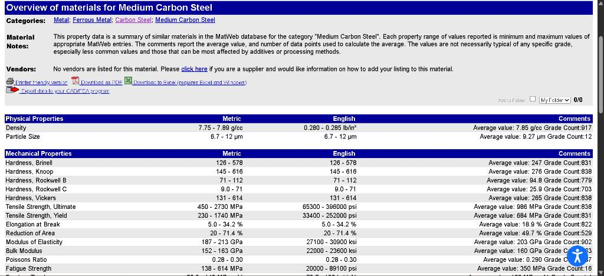

The medium carbon steel has a maximum average yield strength of 684 MPa (Matweb) and can easily handle the crosshead loading of 2 kN while providing a safety factor (FOS) of 4. The hardness and stiffness of the material will not allow any kind of wear to occur due to friction, and it will not bend the screw due to its 18 inches long span. In addition to all of that, it is readily available and is very cheap compared to other alloys or stainless steels.

## Solving for the minimum diameter (axial loading):
### Knowns and Unknowns:
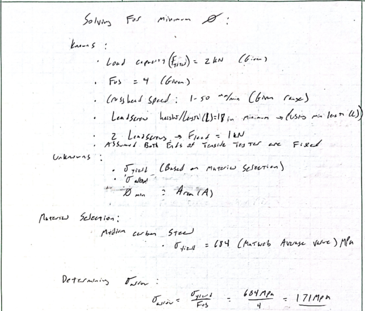

As shown above, the listed knowns and unknowns.

I decided to choose a length (L) of 18 inches due to my goal of having the most cost-effective and efficient lead screw setup. Setting the length to 18 inches allows for proper clearance and thread engagement of all components during the tensile test. Using the given FOS value, we can calculate the required allowable stress.

### Determining minimum diameter:
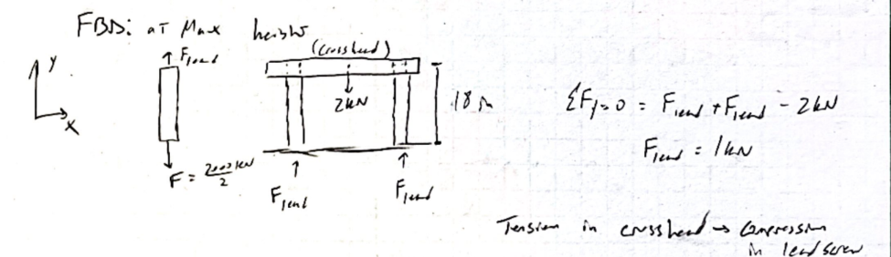

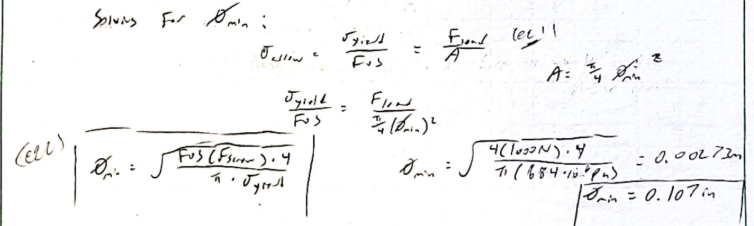

As shown above, the FBD visually tells us that both lead screws equally distribute the crosshead load (2kN); both F_lead values are 1kN.

The assumption for determining the minimum diameter is based on having the lead screws be under axial load only.

In the second picture, eq 1 shows the axial load formula connected to the yield and FOS values. Setting both equations equal to each other allows us to isolate and expand the cross-sectional area (A) and solve for diameter_min (eq 2). In doing so, diameter_min equals 0.107 inches.

### Sizing up minor diameter:
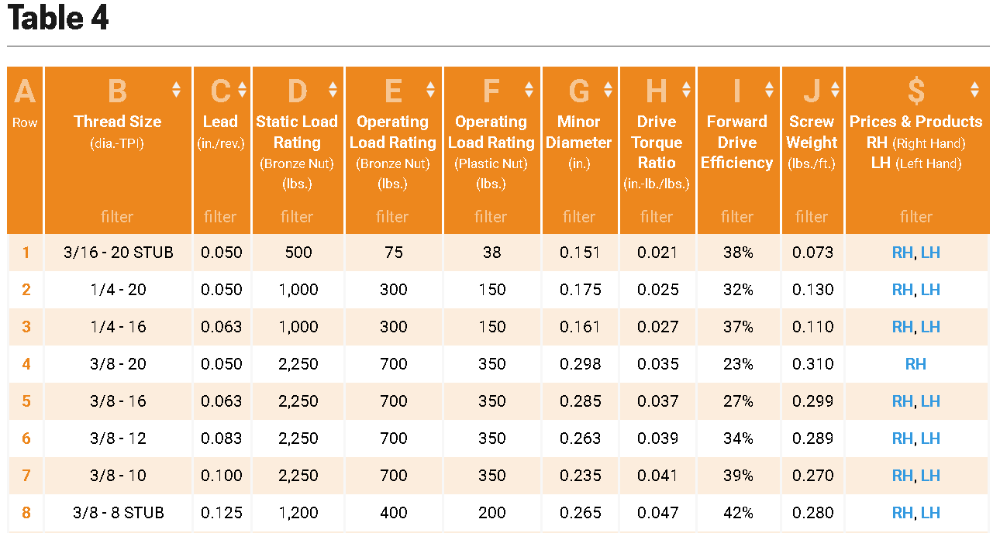

As shown above, the table allows a selection of lead screws. From our calculated values, we decided to select the 3/8 - 8 STUB lead screw. 
Key specifications of this lead screw include:

Lead (c) = 0.125 in/rev
(Keeps the required motor speed low while remaining shallow enough to stay safely self-locking.)

Static Load Rating = 1200 lbs
(1200 lbs per screw, which provides a slight safety buffer. This is optimal for the load per screw (1 kN) to absorb shock or slight misalignment without excessive over-design or failure.)

Minor Diameter = 0.265 inches
(The core diameter is more than double the theoretical minimum core diameter of 0.107 inches, making sure that there will be no buckling of the column within the 18 inches of span with a safety factor of 4 under both axial and torsional loading conditions.)

Forward Drive Efficiency = 42%
(Having 42% efficiency, Acme thread is selected since it means reduced loss due to friction and enables the system to work with a small and economical motor.)

Screw Weight = 0.280 lb/ft (.42lbs per screw)
(Light-weight screws have low rotational inertia, which makes the overall system lighter and affordable to transport and mount.)

Overall, the selection provides a very robust and efficient use of thread geometry. 

## Solving for Range of Rotational Speed (w):
### Knowns and Unknowns:
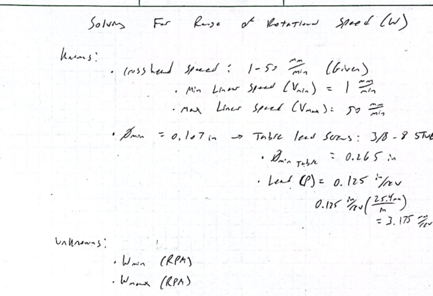

The above shows the knowns and unknowns based on the given and calculated values.

### Solving for (w) speed range:
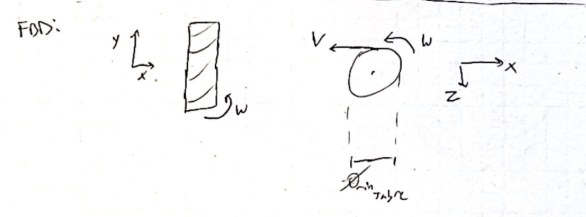

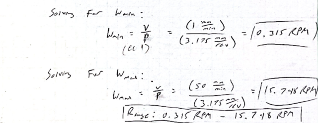

Based on the general equation relating linear velocity to rotational speed through the lead/thread start (eq 1). Eq.1 allows us to get the required units of RPM, and using both ends of the given linear speed range, we can translate it to a range of rotational speeds.

In doing so, we get a minimum value of 0.315 rpm and a maximum value of 15.748 rpm. This range allows us to determine the motor.

## Determining Max Torque (Tmax):
### Knowns and Unknowns:
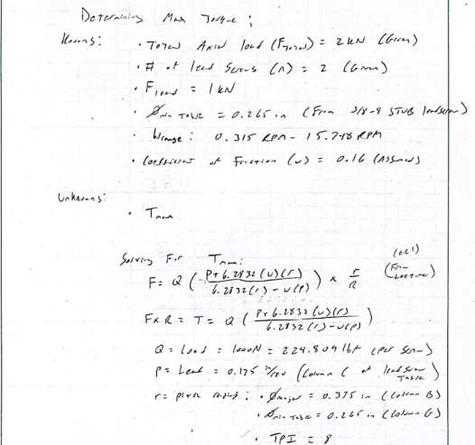

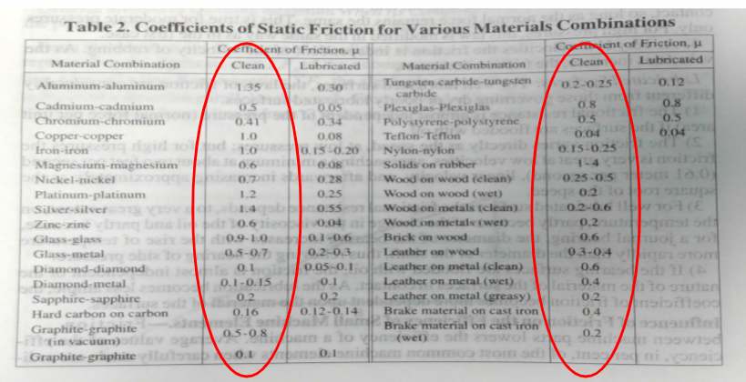

Above shows the list of all parameters we know, calculated, assumed, and missing. We assumed a coefficient of friction to be 0.16 based on the 2 mating materials being hard carbon on carbon; this also helps determine the max torque needed, as it provides a worst-case scenario, assuming no lubrication and pure metal-to-metal contact.

### Solving for Tmax:
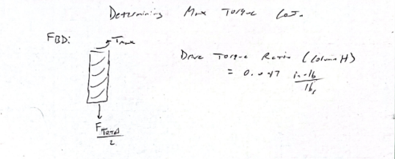

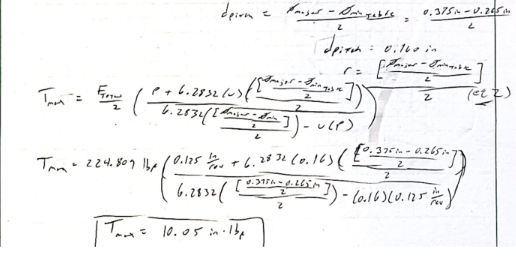

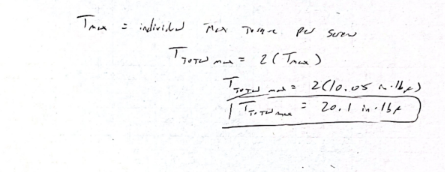

Based on the FBD above, the lead screw experiences half of the total crosshead load in compression, based on the crosshead being elevated and the reaction force of the material pushing back downward, which is transmitted to the leadscrew. Then there is the torque being transmitted by the motor to the leadscrew.

Since torque equals the cross product of force (F) and lever arm (R), we can translate eq 1 to have torque on the left side by dividing by the lever arm. In doing so, we get eq 1, which relates torque to the thread geometry.

Pitch radius of screw can be found by taking the average pitch diameter of both the major diameter (⅜ inch) and minor diameter (0.265 inch) and dividing the average by 2 for the radius (this is seen in eq 2). 

Substituting our variables in for eq 1 and setting the left side equal to torque, we get Tmax equal to 10.05 in-lbf per screw. This causes the total maximum torque for both screws to be 20.1 in-lbf.

## Leadscrew Selection:

After calculating the theoretical minimum minor diameter of 0.107 inches, I decided to increase the overall dimensions to make sure the leadscrew is readily available through standardized diameters. Since the initial assumption of the leadscrew load being only axial, in real-world application, leadscrews experience different types of loads; given the FOS value of 4, I decided to have a 3/8-inch lead screw (which has a minor diameter of 0.265 inches). Then, given my design assumptions of no column buckling, the big increase in solid material makes sense within the context of the tensile tester. The 3/8-inch lead screw also keeps the safety factor of 4 throughout the 18-inch span, without resorting to unnecessarily heavy and costly material. Additionally, with 42% forward drive efficiency and a lead of 0.125 in/rev, the maximum torque of the motor remains low, at 20.1 in-lbs, in the range of 0.315 to 15.75 RPM. Overall, due to the thread profile providing more solid material to sustain the loads, this results in a better strength-to-weight relationship.

## Decide
_Reference your concept selection (Pugh matrix) here. How does this design follow from that decision?_

## Communicate

