## Objective (Sebastian Mateus)
The objective for this stage is to choose an efficient motor and design the complementary drivetrain components (mounting plate and shaft coupling) that will rotate the 3/8-8 STUB screws at speeds from 1 to 50 mm/min. Considering a safety factor of 4 while computing the necessary design torque of 4.54 N·m per screw.

## Motor Selection (Sebastian Mateus)
Starting the motor selection process, the torque and speed needed from the calculations of the 3/8-8 STUB lead screw were multiplied by a factor of 4 to take into account the startup inertia and friction losses. Since the mechanism is distributing the 2 kN crosshead load equally between two separate motors, each one should be able to provide torque no less than 4.54 N·m within an output speed range of 0.315 - 15.75 RPM.

### Knowns and Unknowns:
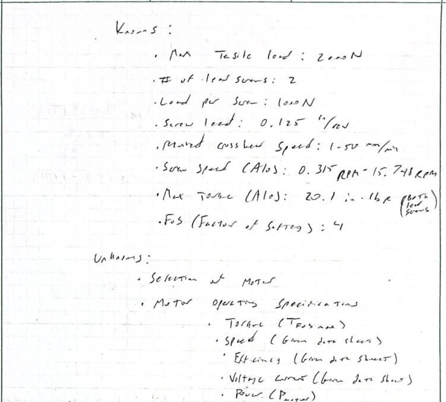

Below are the knowns and unknowns (values connect from A10)

### Solving for Torque (T_FOSmax):

Firstly, we need to incorporate the FOS value into the torque each screw will have. In doing we multiply both terms and get a maximum FOS-based torque of 40.2 in-lbf, this will be classified as the torque implemented by the motor.

### Solving For Power (Pmotor):
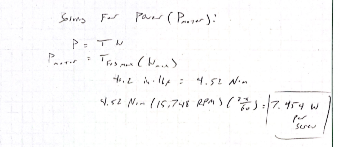

After solving for the torque each motor will produce, we need to translate that value to the power needed. By connecting the max angular speed (w) to the torque value, we get the “worst-case scenario” of how much power is needed. In doing so, we get a value of 7.454 W needed per screw.

### NEMA Stepper Motor Selection:
(a11_1)
(a11_2)
(a11_3)

Based on all the information we have solved for, we decided to select the NEMA 23 Stepper motor with a planetary gearbox with a ratio of 10:1 (23HS22-2804S - HG10). Having a stepper motor is essential in this context because regular ungeared motors do not have the ability to provide 4.52 N·m of torque or rotate seamlessly at ultra-low speeds of 0.315 RPM. Reducing the ratio to 10:1 gears, as shown in the figure above, the speed-torque curve shows
a torque of 6 N·m and 92% efficiency, meeting our requirement for a safety factor of four in a cost-effective manner.

### Motor Specifications:

As shown above and in the previous picture, this motor has an already included keyway. The motor has an existing keyway. This is one of the advantages, since the output shaft, with a diameter of 14 mm, guarantees positive torque transmission without any slippage, which saves machining time and provides a reliable connection of the motor with the 3/8 stub leadscrew. The combination of the holding torque of 1.03 N·m with a 10:1 planetary gearbox will ensure maximum output torque with minimum backlash in the NEMA 23 frame.

### Verifying Specifications:

Given the speed range (w) from A10 and the specifications shown previously, we can calculate both the maximum and minimum speeds that the motor would need to produce. Given the gear ratio of 10:1, the motor turns 10 times for one revolution of the output shaft. Using the planetary gear ratio, we get a minimum speed from the motor of 3.15 RPM and a maximum speed from the motor of 157.48 RPM. Our speed range (w_motor) is now 3.15 - 157.48 RPM; both shaft speeds and motor speeds are allowed for the range of the crosshead (previous constraint of 1–50 mm/min).

Using the given efficiency (n) from the specification sheet, we can check the torque needed for this specific motor using the gear ratio. This torque value (Tmotor) equals 0.4913 N-m. 

As for the supply voltage, 24 V is needed since that is what the torque-speed chart is based on, with a rated current of 2.8A.

Part Number: 23HS22-2804S-HG10

Motor Type: Bipolar Stepper

Holding Torque (without Gearbox): 1.03 N-m

Supply Voltage: 24V

Rated Current/Phase: 2.8 A

Gearbox Type: Planetary

Gear Ratio: 10:1

Efficiency: 92%

Max. Permissible Torque: 6 N-m

Output Shaft Type: Single Shaft with Keyway

Shaft Diameter: 14 mm

Shaft Diameter: 14 mm

## Motor Mount/Bracket: (Sebastian Mateus)

The purpose of the motor mount bracket design is to securely hold the NEMA 23 geared stepper motor and withstand its 1.03 N.m of holding torque through its gearbox with a 10:1 ratio. A stiff structure ensures the motor is perfectly aligned with the leadscrew to prevent shaft bending and deformation.

Given the physical specifications of the motor (square base of 57 x 57mm), we can determine the thickness of the bracket.

### Knowns and Unknowns:

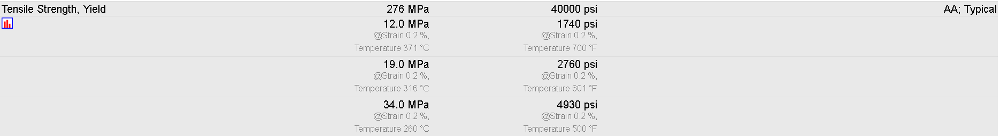

As shown above, we are given the mounting bolt pattern and side dimensions of the base.

I decided to make the base from 6061 T6 aluminum due to its high yield strength (276 MPa); it can withstand the reaction torque and radial forces exerted by the geared NEMA 23 motor without difficulty, while also keeping a lightweight and corrosion-resistant frame. This alloy also has great machinability, which allows it to have good tolerances on the 57 × 57 mm face and shaft bore.

### Solving For Bearing Stress:

As shown above in the FBD, I assumed rotational tangential forces at each mounting hole will reciprocate based on the torque of the output shaft on the motor. We substitute the torque using the equal distribution that each mounting hole will experience, and using the bearing stress cross-sectional area involving the thickness, we can solve for thickness (Th_min) based on the yield and FOS value. 

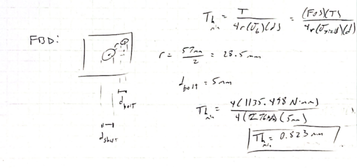

We can also solve for the distance at which each mounting hole will be placed (r) by simply dividing the side dimension of the base by 2 to get r equal to 28.5 mm.

Going back to solving for the thickness (Th_min), we plug in our values and get Th_min equal to 0.823 mm. Given that this is the minimum thickness required for the plate, I decided to increase this value to 8mm due to it being more structurally sound and overall reasonable.

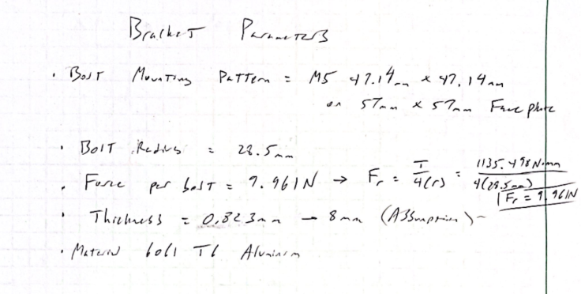

As shown above, we have the parameters so far for designing the bracket. We can solve for the force per bolt (Fr) given the previous equation and get Fr equal to 9.961 N.

### Bracket Design:
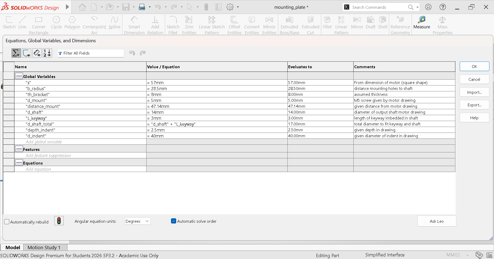

The above shows the parametric equations used for the bracket and the 6061 T6 Aluminum material values.

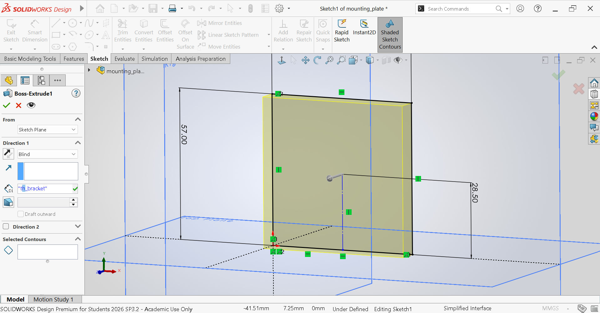

Starting with the square base (similar to the drawings previously shown) and extruding it by the assumed depth (Th_bracket).

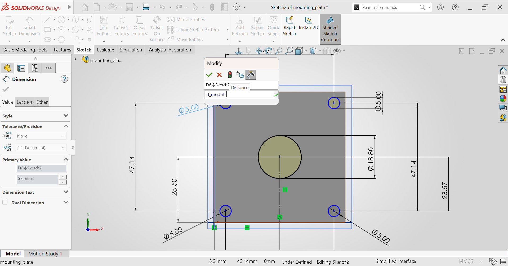
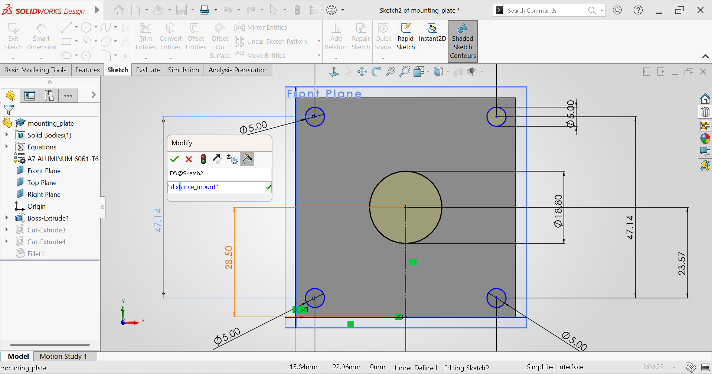
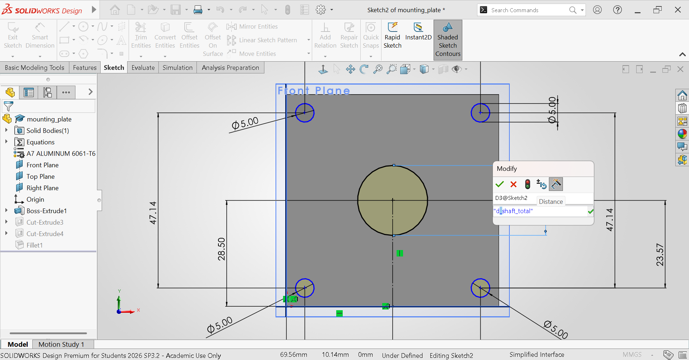

As shown above, I placed the M5 mounting holes given in the drawing alongside the shaft hole.

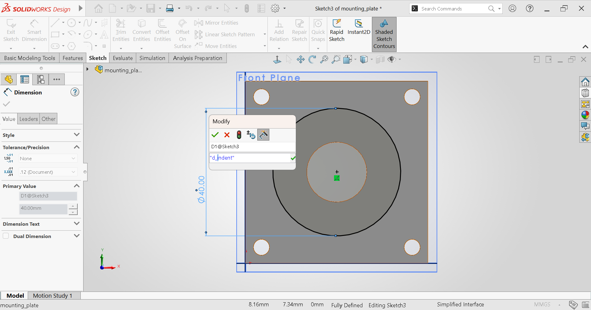

Here, I placed the small indentation as shown in the drawing as well.

Here, I decided to add fillets to each corner to match the motor’s base.

Here is the finalized bracket.

## Shaft/Leadscrew Coupler: (Sebastian Mateus)
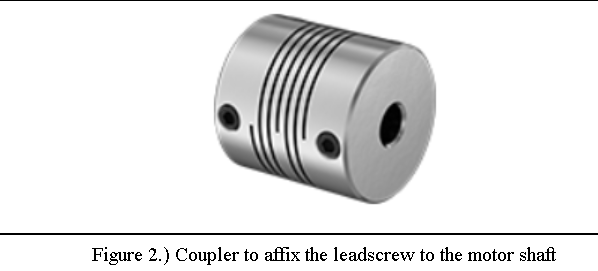

The purpose of the shaft coupler is to ensure a tight connection between the 14 mm keywayed shaft of the 10:1 gear ratio NEMA 23 motor and the 3/8 inches diameter screw shaft, thereby guaranteeing that the torque multiplication will be transferred from the motor to the screw shaft efficiently without slippage or backlash.

### Knowns and Unknowns:
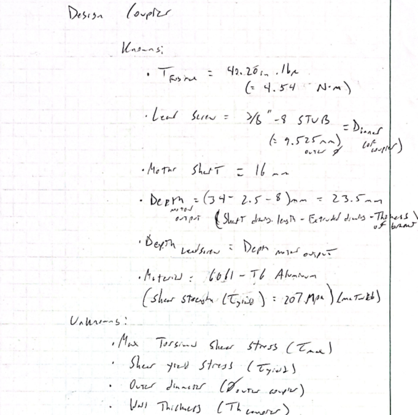

As shown above, we can calculate the remaining length of the shaft by subtracting the section of the shaft from the drawing from the thickness of the bracket and the embedded section. The remaining length comes out to be 23.5mm. We can use this remaining length of the shaft as the depth of each housing of the coupler.

As shown in the FBD, the torque is applied from the motor (T_FOSmax) at the output shaft of the motor, and due to equilibrium, the leadscrew experiences the same torque. Below the FBD are the cross-sections of each end; the leadscrew entry is a simple hollow cylinder with a depth of 23.5 mm, as noted/assumed previously, while the output shaft has the keyway slot.

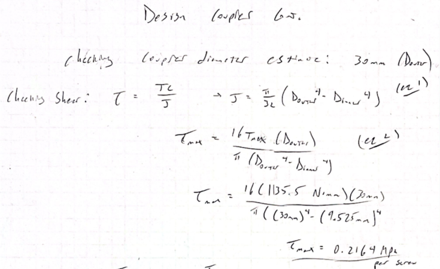

Since the shape of the coupler is a hollow cylinder, I will assume the outer diameter to be 30mm. To check that the 30mm diameter holds for the forces being experienced, we will first check for shear stress. 

Using eq 1 of the general geometry of the hollow cylinder, the polar moment of inertia (J) uses both the outer and inner diameters. Simplifying both formulas, we get eq 2. Plugging in our variables and values, we get a max torsion of 0.2164 MPa, which represents the max shear stress per screw.

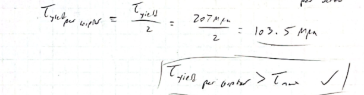

We then need to compare the shear stress based on the material we selected for the coupler. I decided to also have the coupler be made of 6061-T6 aluminum based on the ease of machinability, corrosion resistance, and good shear strength (207 MPa).

Using the shear strength from MatWeb, we need to divide by 2 for each respective coupler. We find that, based on material properties, the yield is greater than that of our assumed 30 mm outer-diameter coupler. This shows us that the 30mm is very robust given our constraints.

We can also check the thickness using the outer diameter (D_outer) of 30mm. Using the shear strength based on the material's shear strength, we solve for Dout (= D_outer). In doing so, we get eq 1; plugging in our values and solving for Dout, we get a value of 20.236mm. This Dout resembles the minimum outer diameter based on the material properties. As shown, 30mm is greater than the minimum; therefore, both checks verify that the assumed 30mm value works.

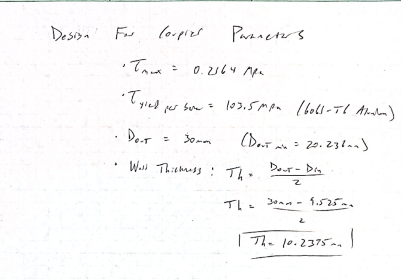

As shown above, these are the important parameters needed to design the coupler. We can solve for the wall thickness of the coupler (Th) using the geometry of the hollow cylinder. In doing so, we get a thickness of 10.2375 mm using our assumed outer diameter value. 

### Designing The Coupler:
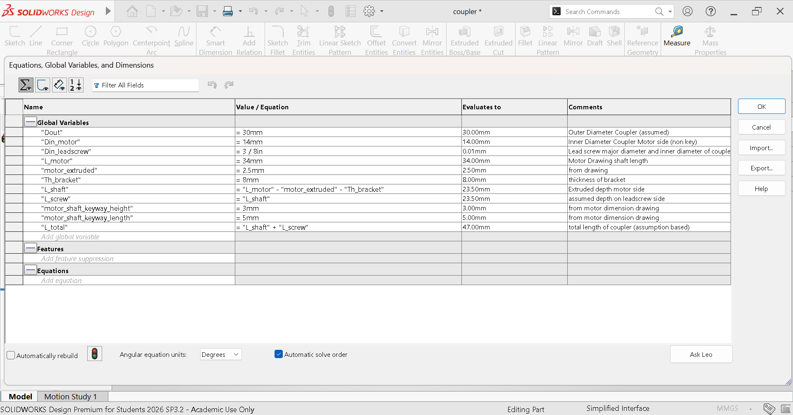

As shown above, here are the parameters used in the design. It is also seen that the length of the remaining shaft already including the thickness of the bracket being 23.5mm and will be counted for the leadscrew depth housing as well. 

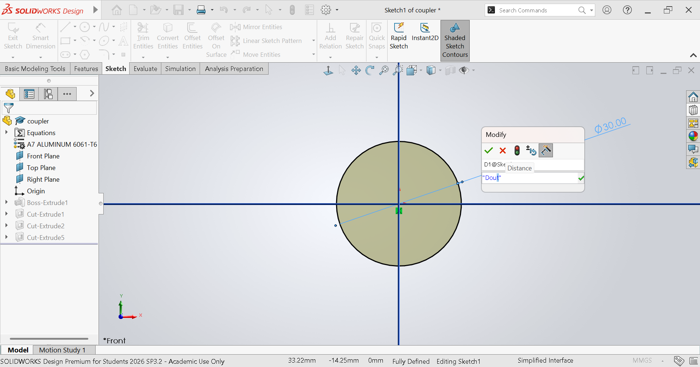

Starting with the coupler design, we set our outer diameter and extruded it to the depth explained earlier.

As shown above, we create the leadscrew housing and set the proper depth.

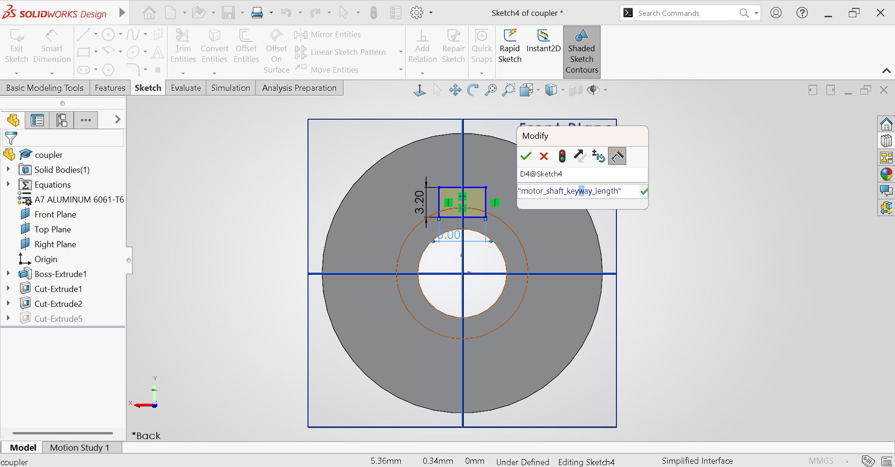

As shown above, we created the motor output housing while also incorporating the already embedded keyway from the motor and the depth. The keyway dimensions were referenced in the dimension drawing from the motor.

Here is the finalized coupler design.

## Motor Assembly: (Sebastian Mateus)
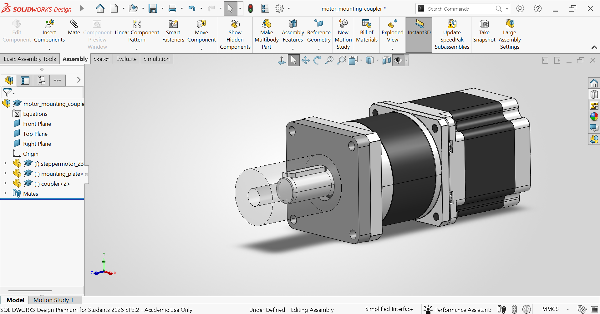

This shows the assembled bracket we designed earlier with the imported motor, all with their respective constraints. The shaft keyway clears the shaft hole.

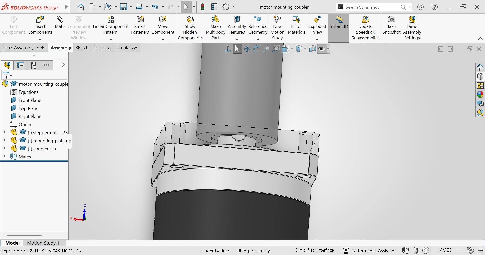

This shows the coupler being in the assembly as well, with its respective constraints. It also shows the clearance of the keyway with its slot.

The above shows the full assembly of the motor (coupler and bracket included, both in 6061 T6 Aluminum)

## Frame Redesign: (Sebastian Mateus)
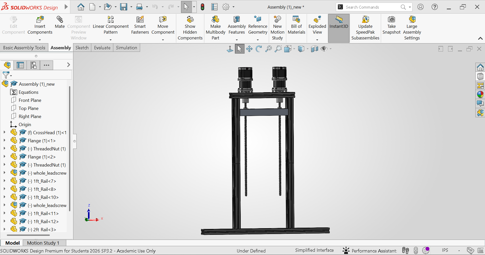

I also decided to redesign the overall frame, include my parts in it, and ensure everything fits properly. 

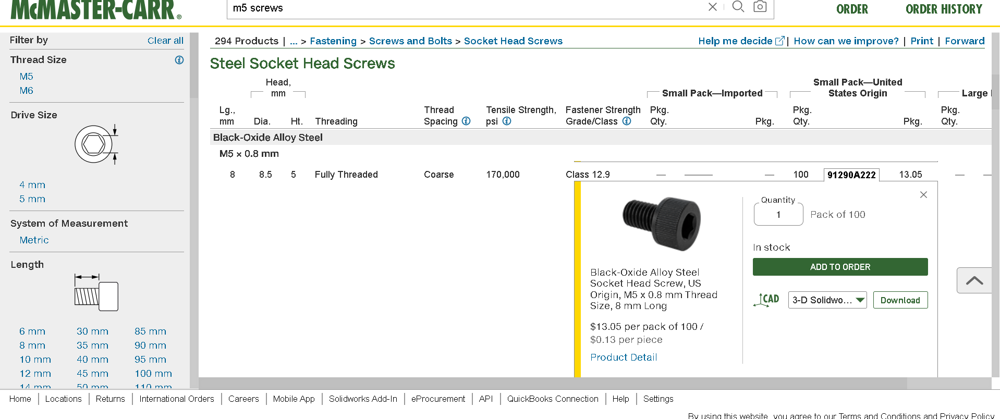

I decided to use these M5 fasteners to mount the motor assembly to the frame.

## Design Floating Bearing Mount (Sebastian Mateus)
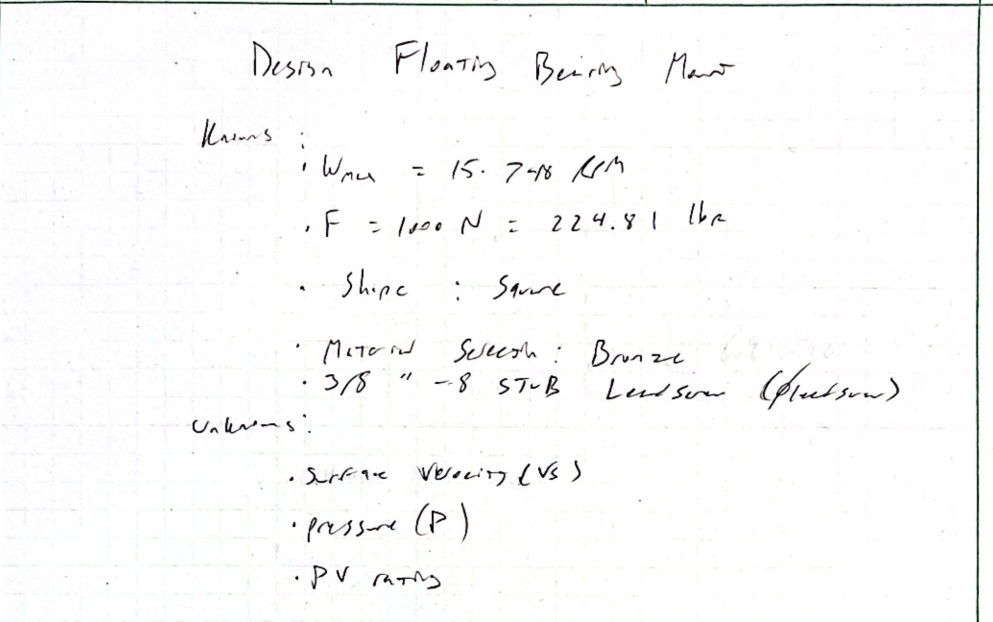

The objective of this section is to design a floating bearing that will be fixed to the base aluminum member in such a way as to radially support the bottom portion of each 3/8"-8 STUB lead screw within a range of 0.315 to 15.75 RPM.

As shown above, the knowns and unknowns allow us to find the necessary parameters for the material selection of the bracket.

### Solving for Surface Velocity:

As shown above, in order to solve for surface velocity, we need to incorporate the major diameter of the leadscrew as well as the worst-case scenario of the rotating speed that the leadscrew will endure. In doing so, we get a surface velocity of 1.5461 FPM. 

### Solving for Pressure (P):

As shown above, solving for the pressure (P) by using the converted force (F) that each leadscrew will get affected by, over the area of the leadscrew. Assuming the leadscrew geometry for simple calculations is a cylinder, we can use its major diameter parameter for its area. In doing so, we get a pressure of 2035.463 PSI. 

### Solving for PV rating:
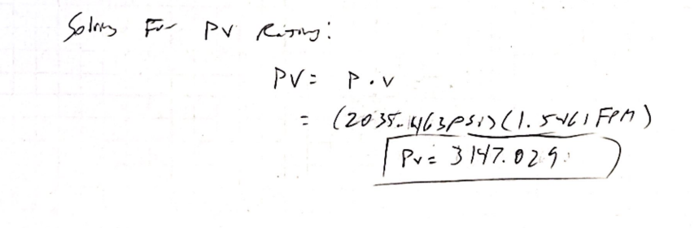

As shown above, the PV rating is simply the product of the surface velocity and the pressure previously solved for. In doing so, we get a PV rating of 3147.029. 

### Floating Bearing Material Selection:

Based on the parameters previously solved for, I chose porous bronze as the material for the bearing. My design of the mount consists of a square bearing bronze plate with a blind bearing pocket at its center and four mounting holes at the corners. Having porous bronze as the material means having a low-friction surface of the journal against a medium-carbon steel lead screw without any additional press-fit bushing. The counterbores hold the lead screw in place from one end, while the holes are for fixing the plate in the tensile tester frame.

Each piece of information from the machinery handbook is labeled with the page number. 

### Designing Bearing

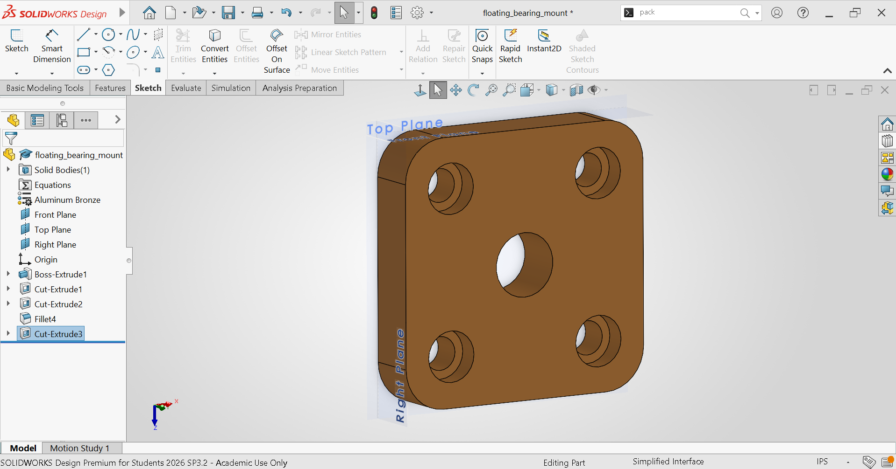

Here are the extruded holes as well as the counterbores.

Here are the material properties used for the floating bearing mount.

## Frame Assembly With Proper Mounting (Sebastian Mateus)

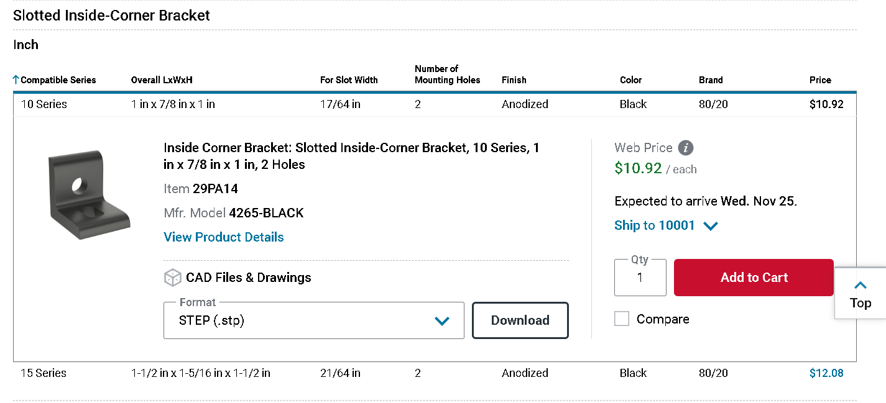

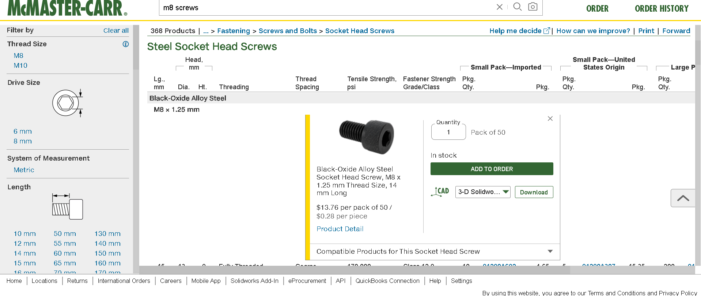

As shown above, I used these combinations of fasteners and brackets. From the front view of the tensile tester, using info from the frame design section. I applied L brackets to all connections of the frame members. I also decided to have an additional member near the end of the leadscrew so the load cell can sit on top (I could not find the load cell STEP file). With the additional member, I decided to have inside corner brackets to support it internally. These specific models were cost-efficient and fit within the frame members. As for the fasteners, I used M8 socket screw heads for the L plates and M5 socket screw heads for the inside corner brackets. Both had reasonable depth and price.

(40 M8 screws)

(16 M5 screws)

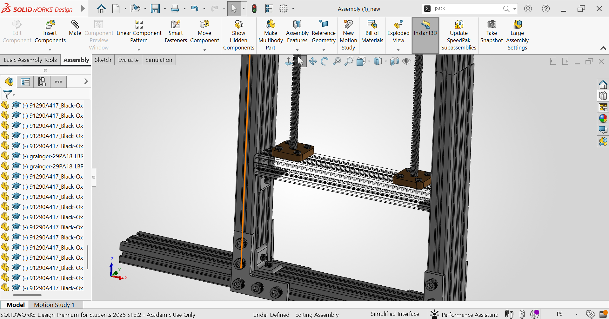

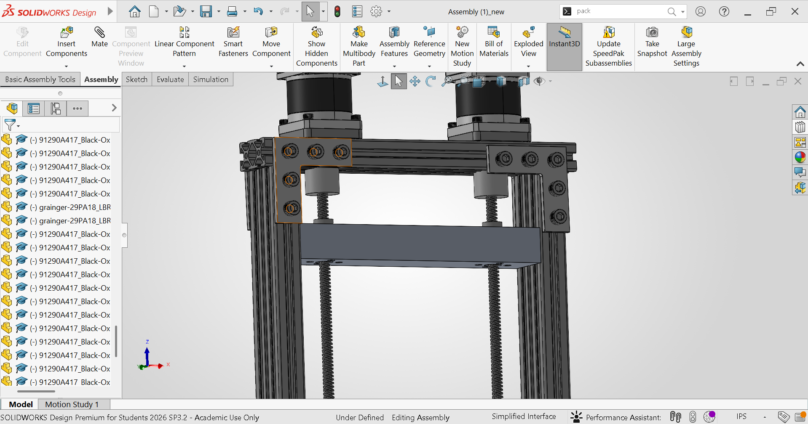

Above shows all the supports as well as the fasteners used.

## Work (Sebastian Mateus)
[Work](a11_work.pdf)

[Work pt 7](a11_7_work.pdf)

The ZIP file on the assembly exceeds the GitHub allowable space. Below is the link to the Google Drive location. SolidWorks was being very buggy with the renaming files and GitHub not liking already set file names from SolidWorks.

[Link, need to download all of these](https://drive.google.com/drive/u/0/folders/1v-8aTL2HnMsP8tA3RaBzPIJepF_N-8xY?ths=true)

## Communicate (Sebastian Mateus)
Time: 16 hours

