# A11 – Motor Selection

## Description:
A tensile tester is a mechanical testing device used to measure how materials respond to uniaxial tension. It applies a controlled pulling force to a specimen while recording the resulting elongation, allowing engineers to determine properties such as yield strength, ultimate tensile strength, and elongation at break. This data is essential for understanding a material’s mechanical behavior and suitability for design applications.

Develop the motorized drive and structural integration for the 2 kN tensile tester, focusing on motor selection, mounting, frame stability, and clamp design. This phase will ensure that the crosshead moves smoothly under controlled torque and speed while maintaining precise load alignment and secure specimen gripping.

Part 2 Scope of Work
- Select a Motor
- Design Motor Mounts
- Select or design a coupler
- Design a Frame to support a crosshead stability and tensile load
- Select or design a Clamp Analysis and Design
- Provide complete CAD model of the engineered parts of the Tensile Tester
- Deliver a Bill of Materials and Engineering Cost

Key Constraints
- No electronics, no software: purely mechanical.
- Load capacity: 2 kN (with appropriate safety factor in structure and drivetrain).
- Speed range: 1–50 mm/min (achieved via screw lead selection).
- Form factor: bench-top footprint favored; manageable overall height; 18 inch leadscrew minimum.
- Safety Factor: 4

## Objective (Sebastian Mateus)
The objective for this stage is to choose an efficient motor and design the complementary drivetrain components (mounting plate and shaft coupling) that will rotate the 3/8-8 STUB screws at speeds from 1 to 50 mm/min. Considering a safety factor of 4 while computing the necessary design torque of 4.54 N·m per screw.

## Motor Selection (Sebastian Mateus)
Starting the motor selection process, the torque and speed needed from the calculations of the 3/8-8 STUB lead screw were multiplied by a factor of 4 to take into account the startup inertia and friction losses. Since the mechanism is distributing the 2 kN crosshead load equally between two separate motors, each one should be able to provide torque no less than 4.54 N·m within an output speed range of 0.315 - 15.75 RPM.

### Knowns and Unknowns:

Below are the knowns and unknowns (values connect from A10)

### Solving for Torque (T_FOSmax):
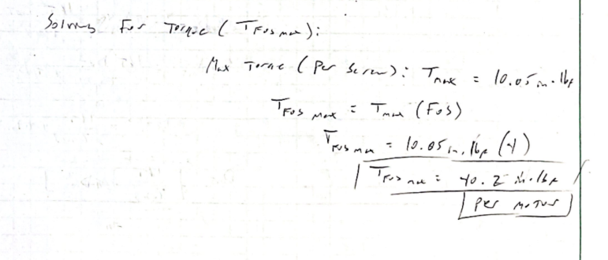

Firstly, we need to incorporate the FOS value into the torque each screw will have. In doing we multiply both terms and get a maximum FOS-based torque of 40.2 in-lbf, this will be classified as the torque implemented by the motor.

### Solving For Power (Pmotor):

After solving for the torque each motor will produce, we need to translate that value to the power needed. By connecting the max angular speed (w) to the torque value, we get the “worst-case scenario” of how much power is needed. In doing so, we get a value of 7.454 W needed per screw.

### NEMA Stepper Motor Selection:
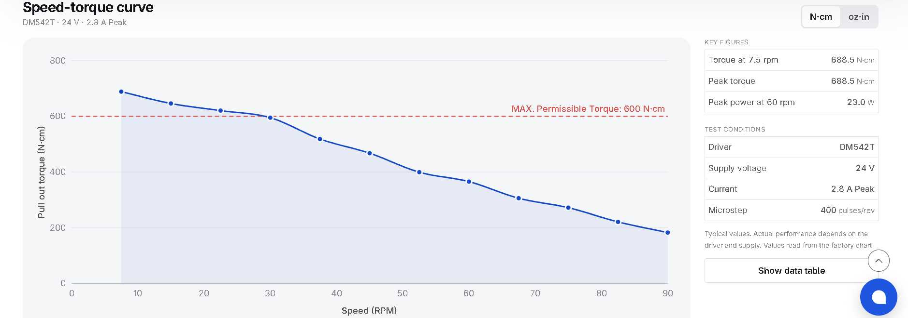
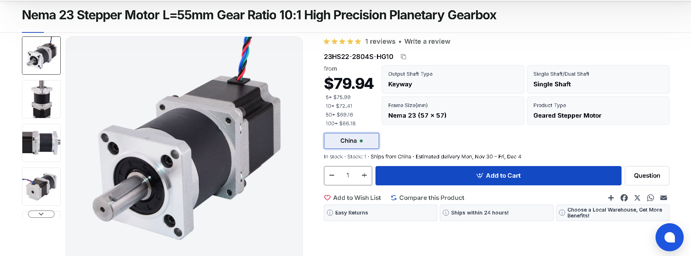
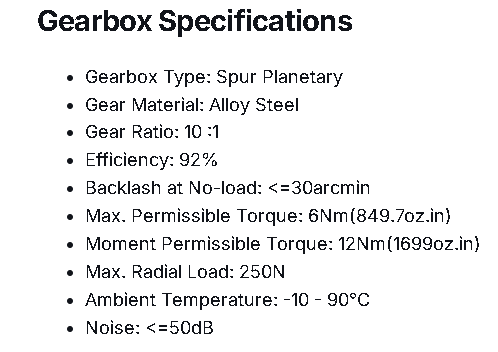

Based on all the information we have solved for, we decided to select the NEMA 23 Stepper motor with a planetary gearbox with a ratio of 10:1 (23HS22-2804S - HG10). Having a stepper motor is essential in this context because regular ungeared motors do not have the ability to provide 4.52 N·m of torque or rotate seamlessly at ultra-low speeds of 0.315 RPM. Reducing the ratio to 10:1 gears, as shown in the figure above, the speed-torque curve shows
a torque of 6 N·m and 92% efficiency, meeting our requirement for a safety factor of four in a cost-effective manner.

### Motor Specifications:
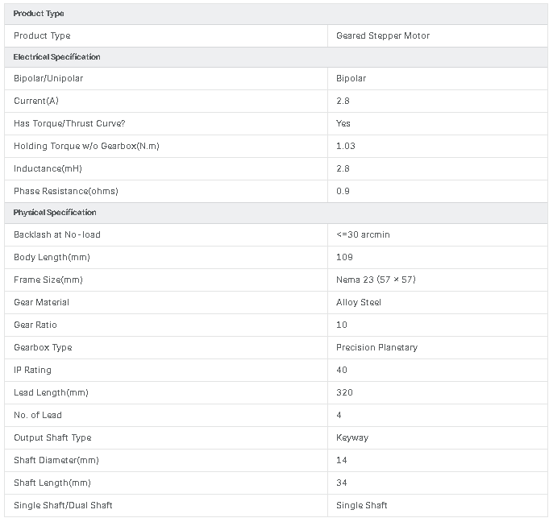

As shown above and in the previous picture, this motor has an already included keyway. The motor has an existing keyway. This is one of the advantages, since the output shaft, with a diameter of 14 mm, guarantees positive torque transmission without any slippage, which saves machining time and provides a reliable connection of the motor with the 3/8 stub leadscrew. The combination of the holding torque of 1.03 N·m with a 10:1 planetary gearbox will ensure maximum output torque with minimum backlash in the NEMA 23 frame.

### Verifying Specifications:
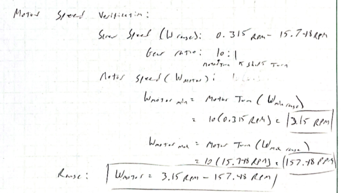

Given the speed range (w) from A10 and the specifications shown previously, we can calculate both the maximum and minimum speeds that the motor would need to produce. Given the gear ratio of 10:1, the motor turns 10 times for one revolution of the output shaft. Using the planetary gear ratio, we get a minimum speed from the motor of 3.15 RPM and a maximum speed from the motor of 157.48 RPM. Our speed range (w_motor) is now 3.15 - 157.48 RPM; both shaft speeds and motor speeds are allowed for the range of the crosshead (previous constraint of 1–50 mm/min).

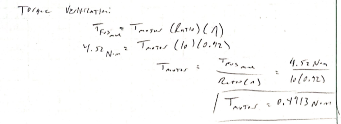

Using the given efficiency (n) from the specification sheet, we can check the torque needed for this specific motor using the gear ratio. This torque value (Tmotor) equals 0.4913 N-m. 

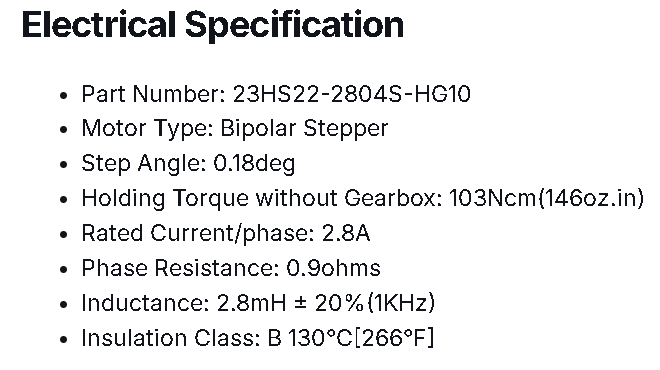

As for the supply voltage, 24 V is needed since that is what the torque-speed chart is based on, with a rated current of 2.8A.

Part Number: 23HS22-2804S-HG10

Motor Type: Bipolar Stepper

Holding Torque (without Gearbox): 1.03 N-m

Supply Voltage: 24V

Rated Current/Phase: 2.8 A

Gearbox Type: Planetary

Gear Ratio: 10:1

Efficiency: 92%

Max. Permissible Torque: 6 N-m

Output Shaft Type: Single Shaft with Keyway

Shaft Diameter: 14 mm

Shaft Diameter: 14 mm

## Motor Mount/Bracket: (Sebastian Mateus)
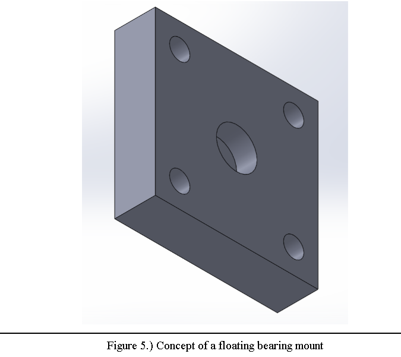
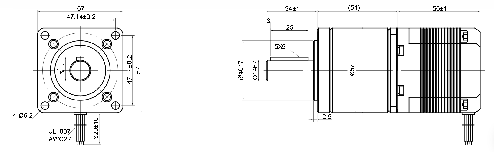
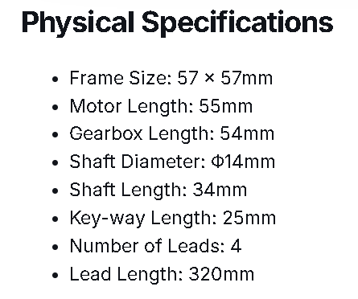

The purpose of the motor mount bracket design is to securely hold the NEMA 23 geared stepper motor and withstand its 1.03 N.m of holding torque through its gearbox with a 10:1 ratio. A stiff structure ensures the motor is perfectly aligned with the leadscrew to prevent shaft bending and deformation.

Given the physical specifications of the motor (square base of 57 x 57mm), we can determine the thickness of the bracket.

### Knowns and Unknowns:
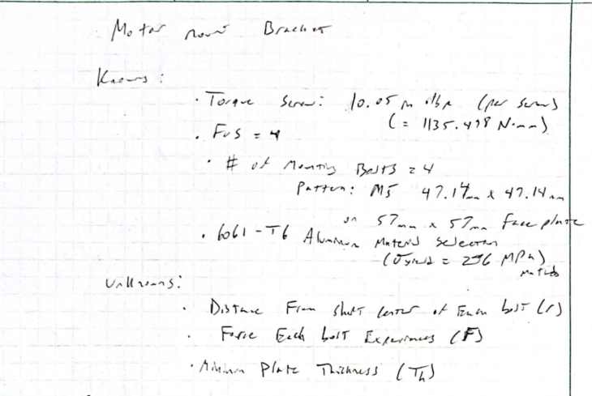

As shown above, we are given the mounting bolt pattern and side dimensions of the base.

I decided to make the base from 6061 T6 aluminum due to its high yield strength (276 MPa); it can withstand the reaction torque and radial forces exerted by the geared NEMA 23 motor without difficulty, while also keeping a lightweight and corrosion-resistant frame. This alloy also has great machinability, which allows it to have good tolerances on the 57 × 57 mm face and shaft bore.

### Solving For Bearing Stress:
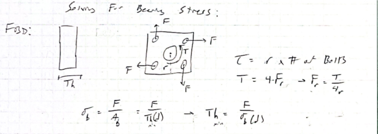

As shown above in the FBD, I assumed rotational tangential forces at each mounting hole will reciprocate based on the torque of the output shaft on the motor. We substitute the torque using the equal distribution that each mounting hole will experience, and using the bearing stress cross-sectional area involving the thickness, we can solve for thickness (Th_min) based on the yield and FOS value. 

We can also solve for the distance at which each mounting hole will be placed (r) by simply dividing the side dimension of the base by 2 to get r equal to 28.5 mm.

Going back to solving for the thickness (Th_min), we plug in our values and get Th_min equal to 0.823 mm. Given that this is the minimum thickness required for the plate, I decided to increase this value to 8mm due to it being more structurally sound and overall reasonable.

As shown above, we have the parameters so far for designing the bracket. We can solve for the force per bolt (Fr) given the previous equation and get Fr equal to 9.961 N.

### Bracket Design:

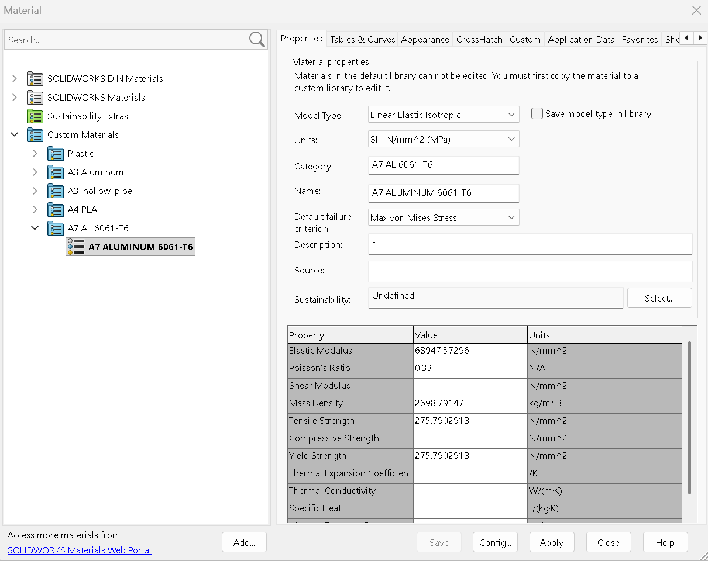

The above shows the parametric equations used for the bracket and the 6061 T6 Aluminum material values.

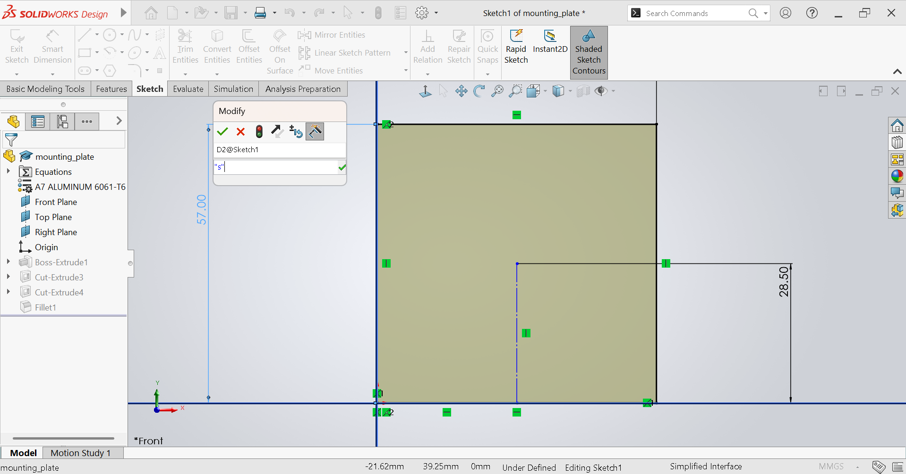

Starting with the square base (similar to the drawings previously shown) and extruding it by the assumed depth (Th_bracket).

As shown above, I placed the M5 mounting holes given in the drawing alongside the shaft hole.

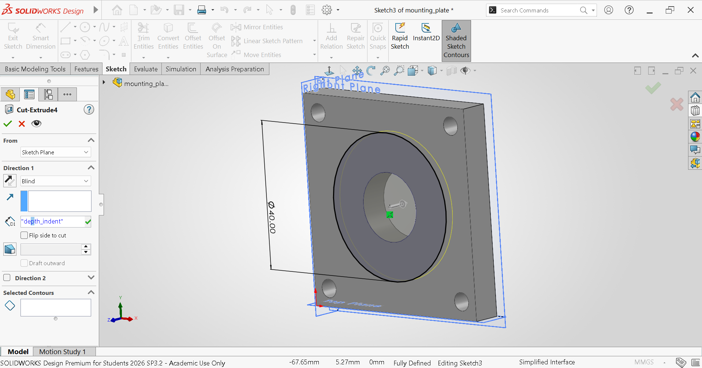

Here, I placed the small indentation as shown in the drawing as well.

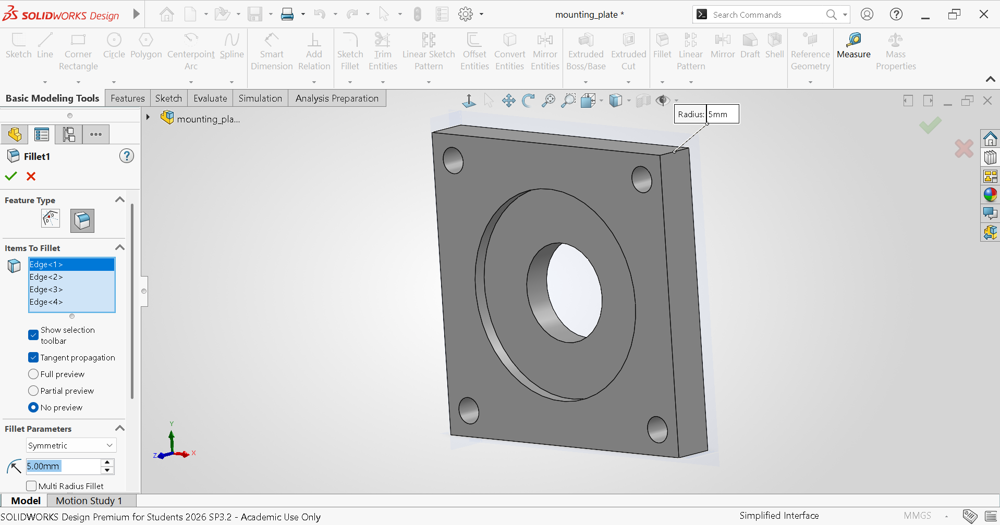

Here, I decided to add fillets to each corner to match the motor’s base.

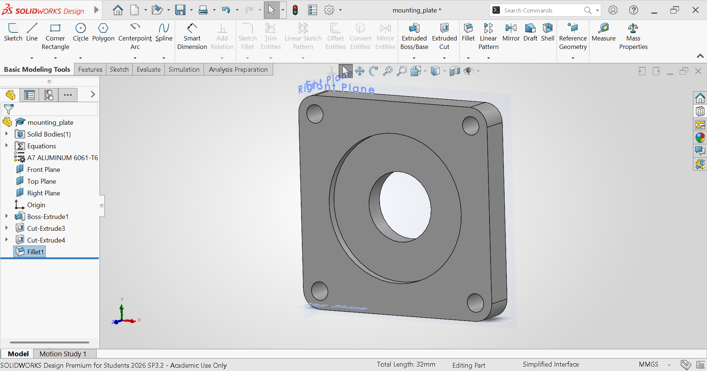

Here is the finalized bracket.

## Shaft/Leadscrew Coupler: (Sebastian Mateus)

The purpose of the shaft coupler is to ensure a tight connection between the 14 mm keywayed shaft of the 10:1 gear ratio NEMA 23 motor and the 3/8 inches diameter screw shaft, thereby guaranteeing that the torque multiplication will be transferred from the motor to the screw shaft efficiently without slippage or backlash.

### Knowns and Unknowns:

As shown above, we can calculate the remaining length of the shaft by subtracting the section of the shaft from the drawing from the thickness of the bracket and the embedded section. The remaining length comes out to be 23.5mm. We can use this remaining length of the shaft as the depth of each housing of the coupler.

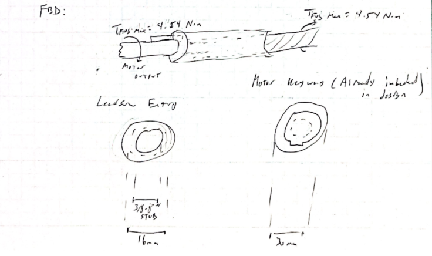

As shown in the FBD, the torque is applied from the motor (T_FOSmax) at the output shaft of the motor, and due to equilibrium, the leadscrew experiences the same torque. Below the FBD are the cross-sections of each end; the leadscrew entry is a simple hollow cylinder with a depth of 23.5 mm, as noted/assumed previously, while the output shaft has the keyway slot.

Since the shape of the coupler is a hollow cylinder, I will assume the outer diameter to be 30mm. To check that the 30mm diameter holds for the forces being experienced, we will first check for shear stress. 

Using eq 1 of the general geometry of the hollow cylinder, the polar moment of inertia (J) uses both the outer and inner diameters. Simplifying both formulas, we get eq 2. Plugging in our variables and values, we get a max torsion of 0.2164 MPa, which represents the max shear stress per screw.

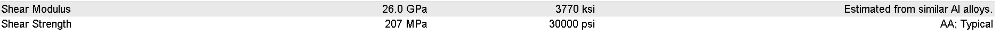

We then need to compare the shear stress based on the material we selected for the coupler. I decided to also have the coupler be made of 6061-T6 aluminum based on the ease of machinability, corrosion resistance, and good shear strength (207 MPa).

Using the shear strength from MatWeb, we need to divide by 2 for each respective coupler. We find that, based on material properties, the yield is greater than that of our assumed 30 mm outer-diameter coupler. This shows us that the 30mm is very robust given our constraints.

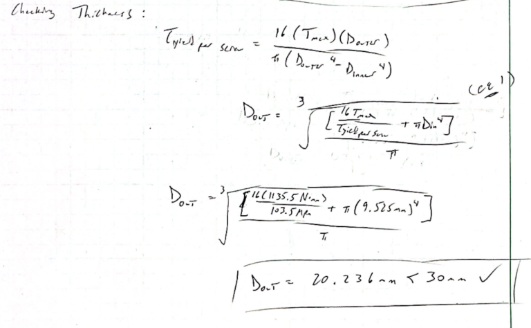

We can also check the thickness using the outer diameter (D_outer) of 30mm. Using the shear strength based on the material's shear strength, we solve for Dout (= D_outer). In doing so, we get eq 1; plugging in our values and solving for Dout, we get a value of 20.236mm. This Dout resembles the minimum outer diameter based on the material properties. As shown, 30mm is greater than the minimum; therefore, both checks verify that the assumed 30mm value works.

As shown above, these are the important parameters needed to design the coupler. We can solve for the wall thickness of the coupler (Th) using the geometry of the hollow cylinder. In doing so, we get a thickness of 10.2375 mm using our assumed outer diameter value. 

### Designing The Coupler:

As shown above, here are the parameters used in the design. It is also seen that the length of the remaining shaft already including the thickness of the bracket being 23.5mm and will be counted for the leadscrew depth housing as well. 

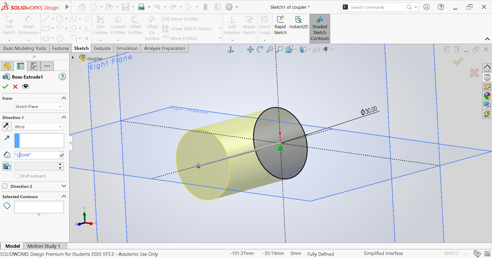

Starting with the coupler design, we set our outer diameter and extruded it to the depth explained earlier.

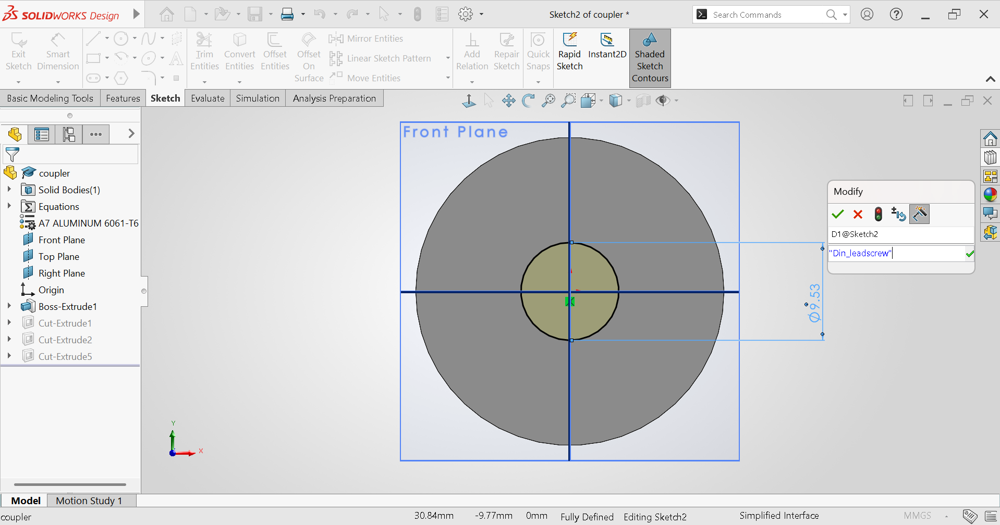
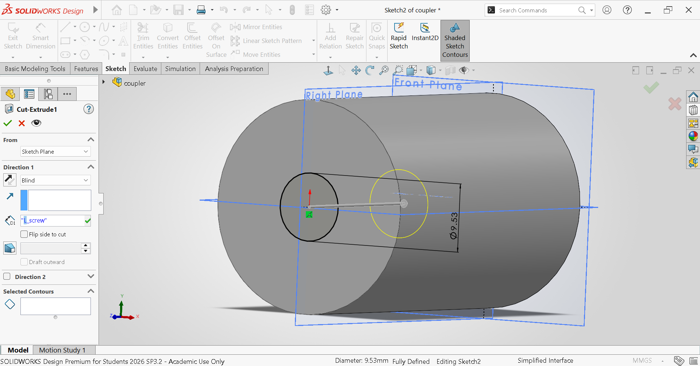

As shown above, we create the leadscrew housing and set the proper depth.

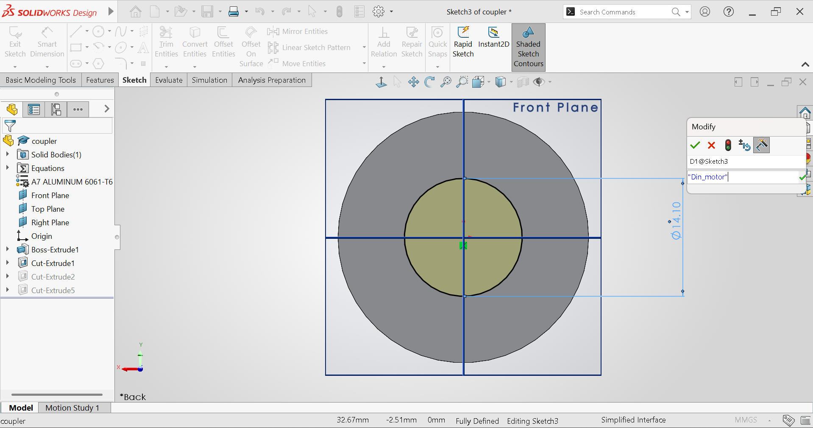
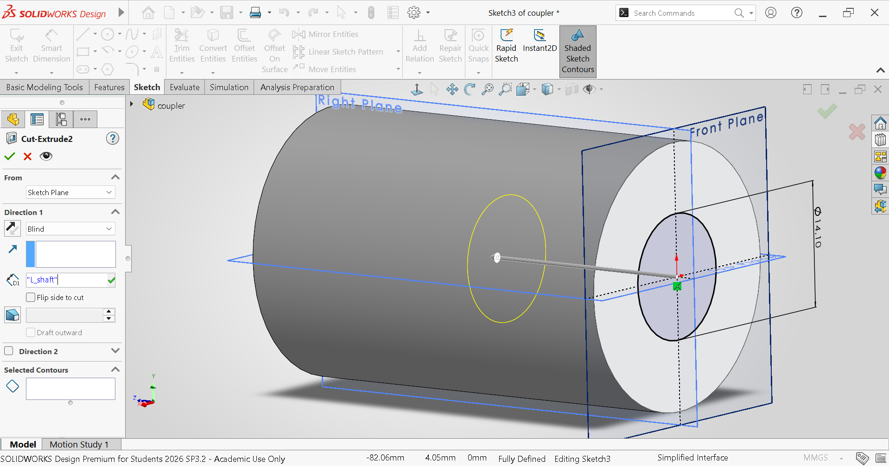

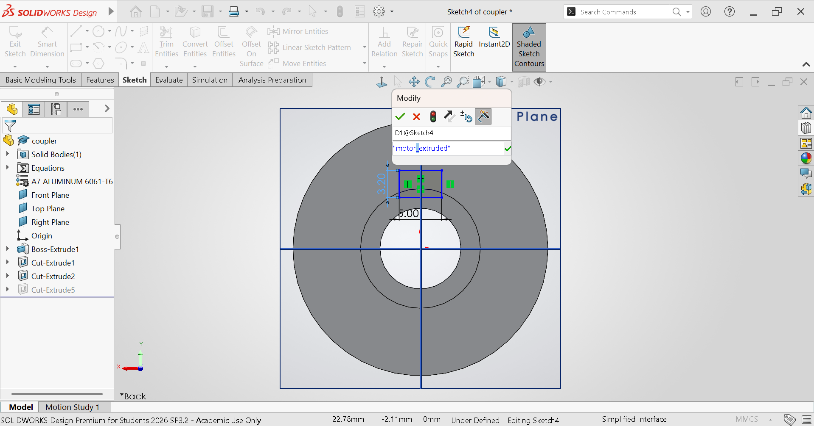

As shown above, we created the motor output housing while also incorporating the already embedded keyway from the motor and the depth. The keyway dimensions were referenced in the dimension drawing from the motor.

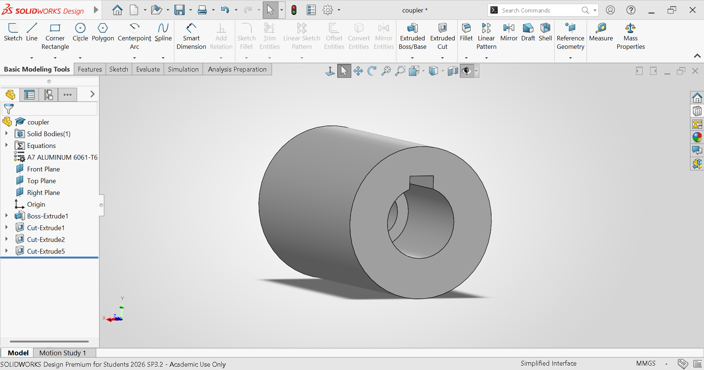

Here is the finalized coupler design.

## Motor Assembly: (Sebastian Mateus)

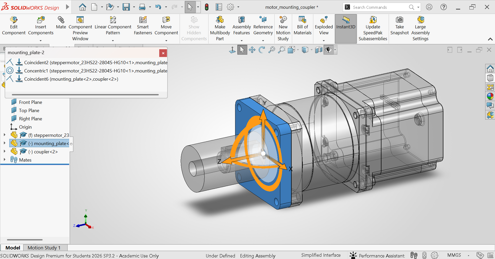

This shows the assembled bracket we designed earlier with the imported motor, all with their respective constraints. The shaft keyway clears the shaft hole.

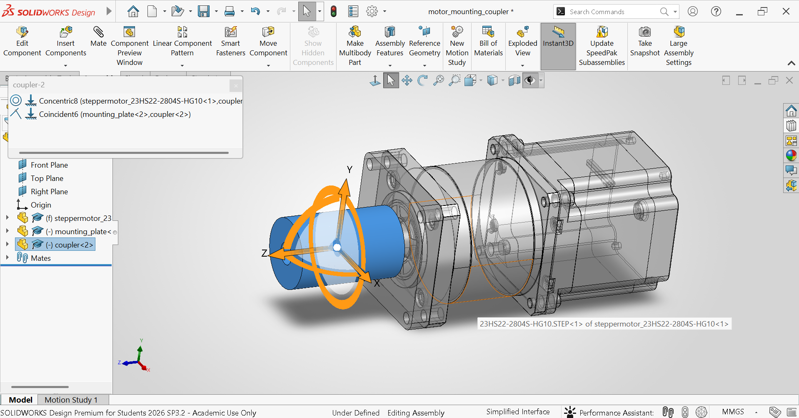

This shows the coupler being in the assembly as well, with its respective constraints. It also shows the clearance of the keyway with its slot.

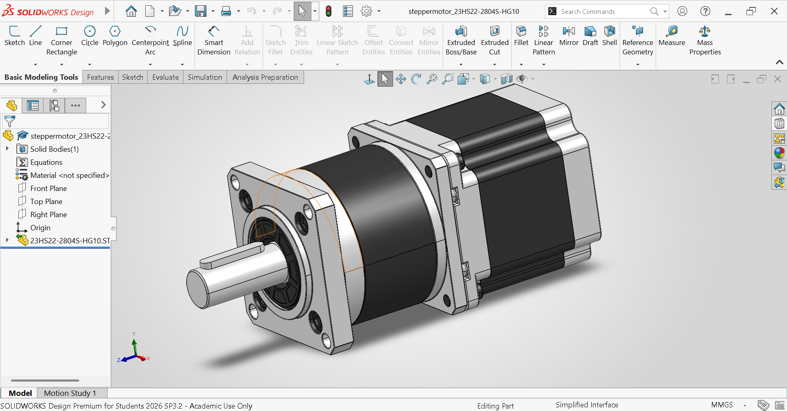
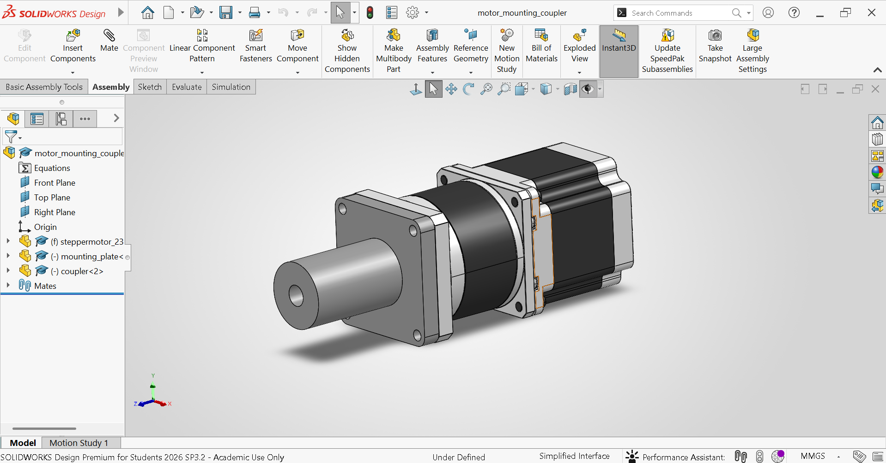

The above shows the full assembly of the motor (coupler and bracket included, both in 6061 T6 Aluminum)

## Frame Redesign: (Sebastian Mateus)

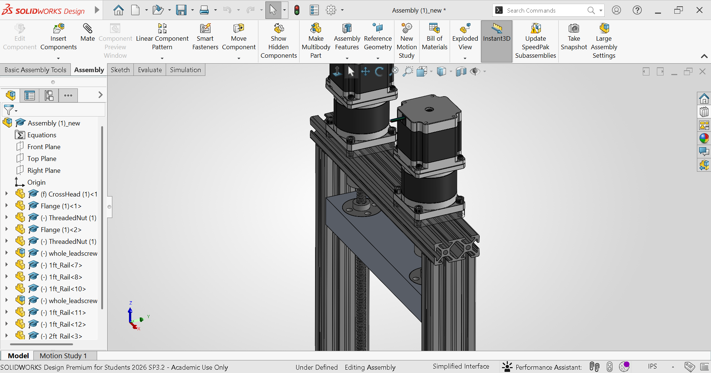

I also decided to redesign the overall frame, include my parts in it, and ensure everything fits properly. 

I decided to use these M5 fasteners to mount the motor assembly to the frame.

## Analyze and design a Frame (Saeed Malik)
### T Slot Framing
The goal of this part is to evaluate the total tensile forces and torque on the top horizontal member of the frame and calculate the stabilizing force needed at the vertical member connections, ensuring that the selected T-slot corner fittings are sufficient enough to withstand the loads with a minimum Factor of Safety of 4.

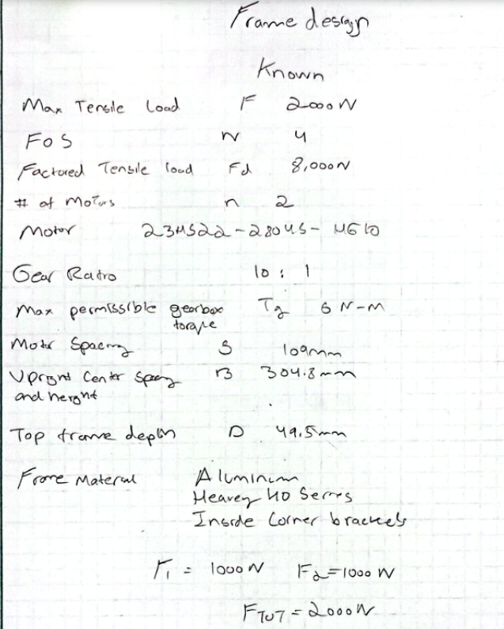

To make sure that a conservative design was obtained, we directly applied the Factor of Safety of 4 to both the maximum tensile force and the maximum allowable torque for the gearbox to get the factored loads (Fd and Td).

Vertical forces acting on the ends (R_Az, R_Bz) and torsion moments acting on the corners (F_c).

Resultant reaction force (R_combined) and shear force on each fastener (V_f).

Shear stress (tau) on fasteners, bearing stress (sigma _b) on the hole and Factor of Safety (FOS).

### Free-Body Diagram (FBD) & Connector Arrangement
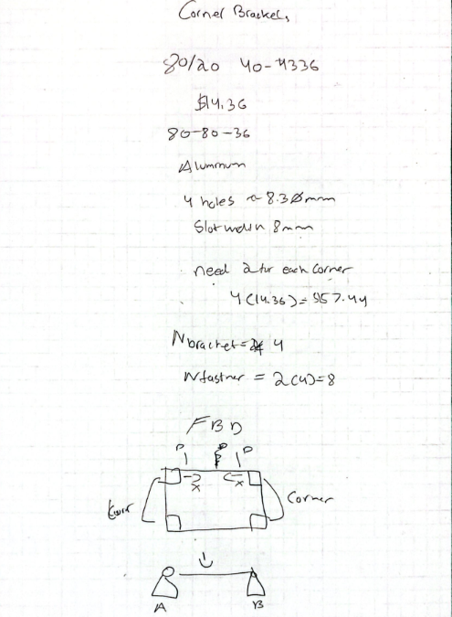
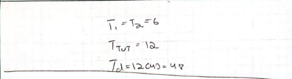
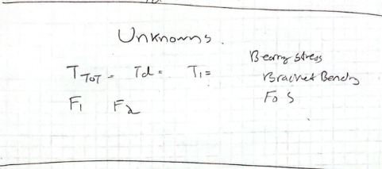

The upper frame member is considered a simply supported beam having a length of 304.8 mm (B) between the left (A) and right (B) vertical uprights:

1. Vertical Load (Side View): The two lead screws impose downward tensile forces (F_1) and (F_2) on the central portion of the member; the vertical forces (R_Az) and (R_Bz) are upward reactions at supports A and B.

2. Horizontal Twisting Torque (Top View): The two motors generate the twisting torque reactions (T_1) and (T_2) around the vertical axis (Z-axis). This twisting torque (T_d = 48 Nm) acts to rotate the top bar horizontally and is opposed by an equal and opposite force couple (F_c) applied transversely at A and B separated by a distance (B = 0.3048 m).

3. Bracket Assembly: Four 80/20 40-4336 inside corner brackets are mounted at each end of the top bar (front and rear slots, 4 brackets in all), using M8 x 16 mm T-slot bolts (75-3422).

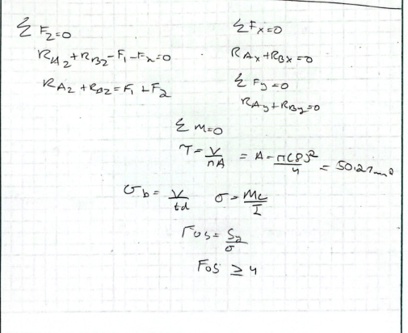

### Symbolic Equilibrium Equations

To symbolize the stabilizing forces required at the ends of the upper beam, force equilibrium is performed in the three coordinate axes, where it can be seen that the horizontal and transverse reactions compensate for each other, whereas the vertical reactions RAz and RBz collectively counteract the total factored tension force (Fd) with a balance that splits the vertical loads in half (Fd / 2) due to symmetry. Afterward, performing a moment equilibrium around the vertical axis reveals that the combined factored motor reaction torque (Td) is resisted by a reverse transverse force couple (Fc) exerted on both ends spaced apart by the upright center distance (B), in which each transverse force is equal to the factored torque divided by the distance of the span (Td / B). Lastly, since the vertical reaction force and the transverse force couple are perpendicular to each other at the corners of the frame, the square root of the sum of the squares (RAz² + Fc²) gives the combined resultant reaction (R_combined).

Applying static equilibrium to the top frame member yields the symbolic reaction equations above.

By symmetry, each upright end carries half of the factored vertical load: R_Az = R_Bz = F_d/2

### Numerical Stress Analysis & Bracket Verification

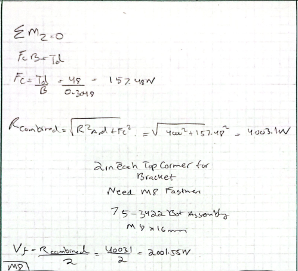
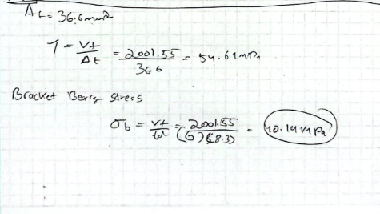

To validate that the chosen fasteners will be able to safely support the top frame, the factored vertical reaction of 4,000 N per upright was combined with the twisting couple force in the horizontal plane of 157.48 N (obtained by dividing the factored torque of 48 N.m by the spacing of 0.3048 m between the uprights), thus resulting in a total factored reaction of 4,003.1 N at each corner. Since there are two 80/20 40-4336 inside corner brackets that share the load at each corner, each of the brackets and their M8 x 16 mm screws (75-3422) would be subjected to the shear load of 2,001.55 N. Calculation of the shear stress based on the 36.6 mm² stress area of the M8 screw results in the value of 54.69 MPa, while the bearing stress on the 6 mm thick wall of the aluminum bracket at the mounting hole diameter of 8.3 mm is calculated as 40.19 MPa.

## Top Frame FEA (Sanjay Kashyap)

### Setting Up the FEA

I had to begin by updating the model for the top frame, but adding the "through all" holes through which the lead screw runs through.

  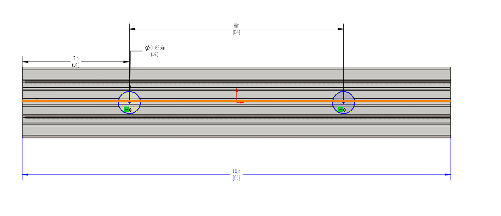

I then applied a fixture to each side of the top frame component.

  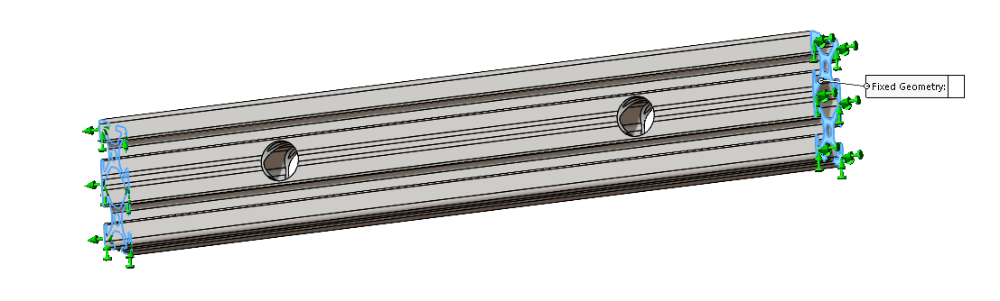

Next I applied a force around the holes and set the force parallel to the side and facing downwards. I selected both holes on the same feature and set the force equal to 2000 N.

  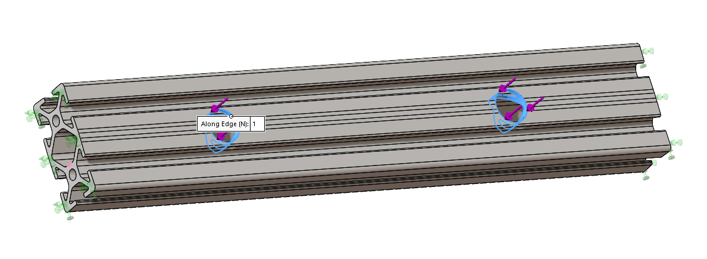

Then I added a reaction torque to the lead screw holes. I did it in one feature with a value of 12 Nm (6 Nm per hole) because the maximum possible output of each motor is 6 Nm.

  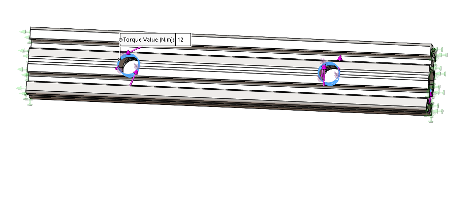

Next, I specified the material. I selected the aluminum allow 4032-T6 which is closes to the real material of the bar which is heavy 40 Series aluminum.

The yield stress of the material is 315,000,000 N/m^2

### Fine Mesh

I created a high quality fine mesh (seen below). Below the picture of the mesh is a screenshot of the mesh details. A notable takeaway from the mesh details chart is that there are 1,110,851 elements in the mesh.

  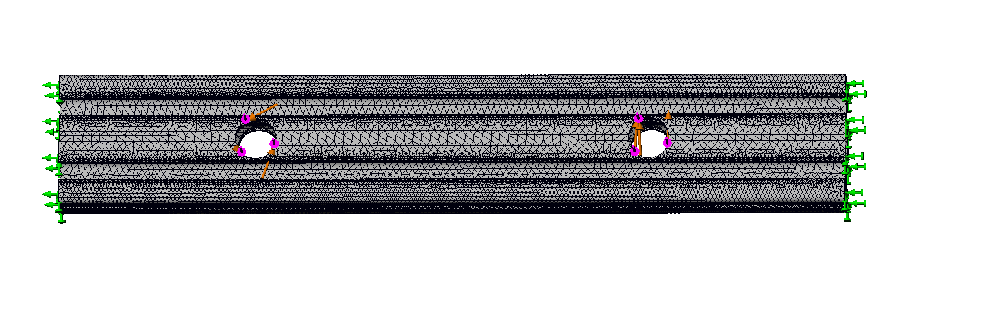

  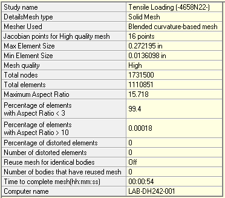

The Next step is to run the study

#### Stress

The maximum stress for the fine mesh is 3.733 * 10 ^8 N/m^2

  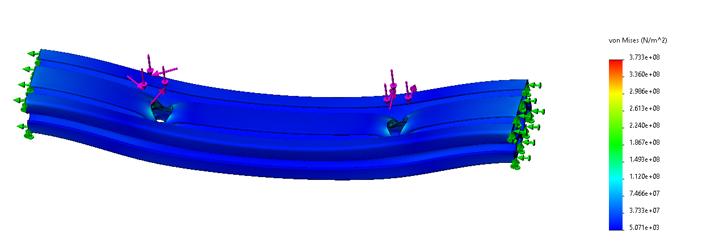

#### Deflection

The maximum deflection is 5.990 * 10^(-2) mm

  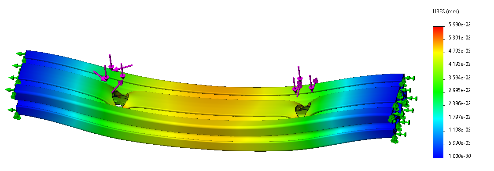

#### Factor of Safety

The factor of safety (FS) is the yield strength of the material divided by the maximum stress. I did the factor of safety based on the stress because it was closer the limit than the deflection.

The Factor of Safety is 0.844 whish is less than 1. According to this simulation the stress is too high.

### Medium Mesh

I created a high quality medium mesh (seen below). Below the picture of the mesh is a screenshot of the mesh details. A notable takeaway from the mesh details chart is that there are 771,392 elements in the mesh.

  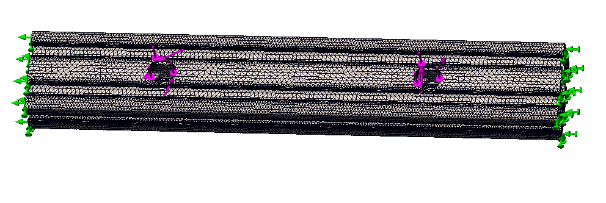

  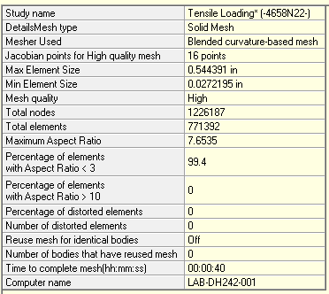

#### Stress

The maximum stress for the fine mesh is 3.817 * 10^8 N/m^2

  

#### Deflection

The maximum deflection is 5.989 * 10^(-2) mm

  

#### Factor of Safety

The factor of safety (FS) is the yield strength of the material divided by the maximum stress. I did the factor of safety based on the stress because it was closer the limit than the deflection.

The Factor of Safety is 0.825 whish is less than 1. According to this simulation the stress is too high.

### Mesh Convergence Test

Below is the formula to calculate the percentage change in maximum stress, maximum resultant displacement, and minimum factor of safety.

  <strong>Change (%) = </strong>
  
    
      |Higher Density's Result − Lower Density's Result|
    
    
      |Higher Density's Result|
    
  
  × 100

<h3 align="center"><u>Top Frame FEA</u></h3>

<table align="center" border="1" cellpadding="10" cellspacing="0">
  <tr>
    <th>Measurements</th>
    <th>Fine Density</th>
    <th>Medium Density</th>
    <th>Change %</th>
  </tr>
  <tr>
    <td>Maximum von Mises Stress (N/m2)</td>
    <td>3.733 &times; 108</td>
    <td>3.817 &times; 108</td>
    <td>2.25%</td>
  </tr>
  <tr>
    <td>Maximum Resultant Displacement (mm)</td>
    <td>5.990 &times; 10&minus;2</td>
    <td>5.989 &times; 10&minus;2</td>
    <td>0.017%</td>
  </tr>
  <tr>
    <td>Factor of Safety (FS)</td>
    <td>0.844</td>
    <td>0.825</td>
    <td>2.25%</td>
  </tr>
</table>

The percentages are low, meaning the results are stabilized. I will continue with the results from the fine mesh because they are more accurate since there are more points of reference in the simulation.

### Suggested Changes

A change that I would suggest is adding triangular gusset reinforcements to the two upper interior corners of the assembly. These reinforcements would help transfer the forces from the top frame toward the vertical supports rather than requiring the top frame to carry the loads across its entire length. This should reduce bending stresses in the top frame. I would also expect the critical stress locations to potentially shift toward the gussets' attachment points or the connections between the top frame and vertical supports.

## Vertical Frame FEA (Sanjay Kashyap)

I originally wanted to open the original assembly and delete the extra components, but I needed to recreate it from scratch because the tope frame did not have any holes in it and used the same model as the vertical frame components. I then created a new assemble that only consisted of the vertical fram component and the top frame which transfers load onto the vertical frame components.

  

### Setting up FEA

I applied aluminum allow 4032-T6 as the material for each component of the simulation. Next, I applied a fixture to the bottom of the two vertical frames.

  

Next I applied an force around the holes and set the force parallel to the side and facing downwards. I selected both holes on the same feature and set the force equal to 2000 N.

  

Then I added a reaction torque to the lead screw holes. I did it in one feature with a value of 12 Nm (6 Nm per hole) because the maximum possible output of each motor is 6 Nm.

  

### Fine Mesh

I created a high quality fine mesh (seen below). Below the picture of the mesh is a screenshot of the mesh details. A notable takeaway from the mesh details chart is that there are 3,375,640 elements in the mesh.

  

  

#### Stress

The maximum stress for the fine mesh is1.641 * 10^11 N/m^2

  

I attached a phot of the stress simulation from the side for an alternate view.

  

#### Deflection

The maximum deflection is 1.428 * 10^(-1) mm

  

  

#### Factor of Safety

The factor of safety (FS) is the yield strength of the material divided by the maximum stress. I did the factor of safety based on the stress because it was closer the limit than the deflection.

The yield strength of the material is 315,000,000 N/m^2 which means the factor of safety is 0.0019. According to this simulation the stress is too high.

### Medium Mesh

I created a high quality fine mesh (seen below). Below the picture of the mesh is a screenshot of the mesh details. A notable takeaway from the mesh details chart is that there are 996,834 elements in the mesh.

  

  

#### Stress

The maximum stress for the fine mesh is 2.537 * 10^11 N/m^2

  

#### Deflection

The maximum deflection is 1.428 * 10^(-1) mm

  

#### Factor of Safety

The factor of safety (FS) is the yield strength of the material divided by the maximum stress. I did the factor of safety based on the stress because it was closer the limit than the deflection.

The yield strength of the material is 315,000,000 N/m^2 which means the factor of safety is 0.0012. According to this simulation the stress is too high.

### Mesh Convergence Test

Below is the formula to calculate the percentage change in maximum stress, maximum resultant displacement, and minimum factor of safety.

  <strong>Change (%) = </strong>
  
    
      |Higher Density's Result − Lower Density's Result|
    
    
      |Higher Density's Result|
    
  
  × 100

<h3 align="center"><u>Vertical Components FEA</u></h3>

<table align="center" border="1" cellpadding="10" cellspacing="0">
  <tr>
    <th>Measurement</th>
    <th>Fine Mesh</th>
    <th>Medium Mesh</th>
    <th>Percent Change</th>
  </tr>
  <tr>
    <td>Von Mises Maximum Stress (N/m2)</td>
    <td>1.641 &times; 1011</td>
    <td>2.537 &times; 1011</td>
    <td>54.60%</td>
  </tr>
  <tr>
    <td>Maximum Deflection (mm)</td>
    <td>1.428 &times; 10&minus;1</td>
    <td>1.417 &times; 10&minus;1</td>
    <td>0.77%</td>
  </tr>
  <tr>
    <td>Factor of Safety</td>
    <td>0.0019</td>
    <td>0.0012</td>
    <td>36.84%</td>
  </tr>
</table>

The deflection is stabilized, so I will analyze the design based off of deflection. I will still utilize the visual of the stress concentration to decide as the concentration locations remain the same as well as I will be making recommendations with the knowledge that in both simulations the safety factor is far below 1.

### Design Changes

I believe it would be beneficial to add triangular gusset reinforcements to each corner of the frame. These could attach to the base of the assembly, particularly near the existing fixtures at the bottom of the vertical supports. I also think adding reinforcement plates around the middle of the top frame would be beneficial. Using a material with a higher yield strength could improve the load-bearing capacity in these areas and help distribute the applied forces. Finally, I would consider adding two diagonal support beams extending from the base to the top frame, with one beam on each side of the assembly. These supports would be positioned on the sides experiencing the greatest deflection and would help transfer some of the loading directly into the base rather than requiring the top frame to resist as much bending. I would expect these changes to reduce overall deflection and stress in the original frame, although the critical stress locations could shift toward the new reinforcement connections.

## Design Floating Bearing Mount (Sebastian Mateus)

The objective of this section is to design a floating bearing that will be fixed to the base aluminum member in such a way as to radially support the bottom portion of each 3/8"-8 STUB lead screw within a range of 0.315 to 15.75 RPM.

As shown above, the knowns and unknowns allow us to find the necessary parameters for the material selection of the bracket.

### Solving for Surface Velocity:

As shown above, in order to solve for surface velocity, we need to incorporate the major diameter of the leadscrew as well as the worst-case scenario of the rotating speed that the leadscrew will endure. In doing so, we get a surface velocity of 1.5461 FPM. 

### Solving for Pressure (P):

As shown above, solving for the pressure (P) by using the converted force (F) that each leadscrew will get affected by, over the area of the leadscrew. Assuming the leadscrew geometry for simple calculations is a cylinder, we can use its major diameter parameter for its area. In doing so, we get a pressure of 2035.463 PSI. 

### Solving for PV rating:

As shown above, the PV rating is simply the product of the surface velocity and the pressure previously solved for. In doing so, we get a PV rating of 3147.029. 

### Floating Bearing Material Selection:

Based on the parameters previously solved for, I chose porous bronze as the material for the bearing. My design of the mount consists of a square bearing bronze plate with a blind bearing pocket at its center and four mounting holes at the corners. Having porous bronze as the material means having a low-friction surface of the journal against a medium-carbon steel lead screw without any additional press-fit bushing. The counterbores hold the lead screw in place from one end, while the holes are for fixing the plate in the tensile tester frame.

Each piece of information from the machinery handbook is labeled with the page number. 

### Designing Bearing

Here are the extruded holes as well as the counterbores.

Here are the material properties used for the floating bearing mount.

## Frame Assembly With Proper Mounting (Sebastian Mateus)

As shown above, I used these combinations of fasteners and brackets. From the front view of the tensile tester, using info from the frame design section. I applied L brackets to all connections of the frame members. I also decided to have an additional member near the end of the leadscrew so the load cell can sit on top (I could not find the load cell STEP file). With the additional member, I decided to have inside corner brackets to support it internally. These specific models were cost-efficient and fit within the frame members. As for the fasteners, I used M8 socket screw heads for the L plates and M5 socket screw heads for the inside corner brackets. Both had reasonable depth and price.

(40 M8 screws)

(16 M5 screws)

(8 L-Brackets Used)

(4 Inside Corner Brackets)

Above shows all the supports as well as the fasteners used.

## Work (Sebastian Mateus)
[Work](a11_work.pdf)

[Work pt 7](a11_7_work.pdf)

The ZIP file on the assembly exceeds the GitHub allowable space. Below is the link to the Google Drive location. SolidWorks was being very buggy with the renaming files and GitHub not liking already set file names from SolidWorks.

[Link, need to download all of these](https://drive.google.com/drive/u/0/folders/1v-8aTL2HnMsP8tA3RaBzPIJepF_N-8xY?ths=true)

## Communicate (Sebastian Mateus)
Time: 16 hours

### Bill of Materials and Labor Cost (Saeed Malik)

| **Item Number** | **Quantity** | **Name**                                           | **Cost/Item** | **Cost** | **Purchase Link** |
| :-------------: | :----------: | :------------------------------------------------- | ------------: | -------: | :--------------- |
| 1530            | 5            | 1.50” X 3.00” T-Slotted Profile - Six Open T-Slots | $25.51        | $127.55  | [80/20](https://8020.net/1530.html) |
| 95082A641       | 2            | Lead Screw Nut Flange                              | $37.06        | $74.12   | [McMaster-Carr](https://www.mcmaster.com/products/nuts/thread-size~3-8-8/) |
| 95072A124       | 2            | 673 Bronze Stub Acme Nut, 3/8"-8                   | $28.72        | $57.44   | [McMaster-Carr](https://www.mcmaster.com/products/lead-screw-nuts/thread-size~3-8-8/) |
| 99030A986       | 2            | 1018 Carbon Steel Precision Acme Lead Screw        | $11.40        | $22.80   | [McMaster-Carr](https://www.mcmaster.com/99030A986/) |
| 91290A222       | 40           | M8 Black-Oxide Alloy Steel Socket Head Screws      | $0.28         | $11.20   | [McMaster-Carr](https://www.mcmaster.com/products/91290a222/) |
| 29PA18          | 8            | 80/20 L-Bracket, 10 Series                          | $14.44        | $115.52  | [Grainger](https://www.grainger.com/product/80-20-L-Flat-Plate-L-Flat-Plate-29PA18) |
| 29PA14          | 4            | 80/20 Slotted Inside-Corner Bracket                 | $10.92        | $43.68   | [Grainger](https://www.grainger.com/product/80-20-Inside-Corner-Bracket-Slotted-29PA14) |
| 91290A222      | 16           | M5 x 0.8 mm Thread Screw                           | $0.13         | $2.08    | [McMaster-Carr](https://www.mcmaster.com/products/91290a222/) |
|                 |              | **Total Cost**                                     |               | **$454.39** | |

|                 |              |            |        |
| --------------- | ------------ | ---------- | ------ |
| **Design Cost** |              |            |        |
| Person          | Hours Worked | Cost/Hour  | Cost   |
| Sanjay Kashyap     | 15           | $35        | $525.00 |
| Sebastian Mateus  | 16            | $35        | $280.00 |
|                 |              | **Total Cost** | **$805.00** |

**Total Project Cost: $1,259.39**

- Material Cost: $454.39
- Design Cost: $805.00

## Communicate
I have linked below the zip file, which includes all of our individual parts and the final assembly for this project.

- <a href="./final a11.zip" download>Zip File</a>

### Lessons Learned
Sanjay and Sebastian spent around 16 hours each on this assignment, Saeed spent around 9 hours, for a total of 41 hours. Each of us learned a lot, Sanjay learned how to properly align things to mate in assemblies for CAD and how to apply the mesh in certain areas. Sebastian learned how to design the bearing mount, especially the calculations that go along with that. Saeed learned how to properly design for the thickness of frame using stress equations. All in all, we all spent a lot of time on this assignment and in turn learned a lot from it. 
